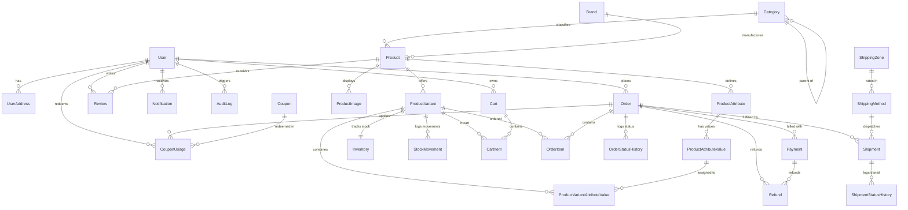

# Data Model Specification — Single-Vendor E-Commerce

**Project:** Single-Vendor Physical Products E-Commerce Platform  
**Database:** PostgreSQL 18  
**ORM:** Prisma 7 (`@prisma/adapter-pg`)  
**Status:** Approved & Finalized  
**Source Documents:**
- [PRD.md](file:///c:/xampp/htdocs/office/az-ecommerce/docs/PRD.md)
- [admin-dashboard-design.md](file:///c:/xampp/htdocs/office/az-ecommerce/docs/admin-dashboard-design.md)
- [admin-dashboard-decisions.md](file:///c:/xampp/htdocs/office/az-ecommerce/docs/admin-dashboard-decisions.md)

---

## 1. Executive Summary

This document defines the complete relational database schema for the single-vendor e-commerce platform. It models all operational domains: authentication and role authorization, product catalog with variants and attributes, stock reservation and ledger auditing, persistent carts, three-axis order fulfillment, Cash on Delivery payments and refunds, zone-based shipping, coupon abuse prevention, customer product reviews, in-app notifications, and store settings with administrative audit logs.

---

## 2. Entity-Relationship Overview



---

## 3. Enumerations Glossary

| Enum Name | Values | Purpose |
|---|---|---|
| **`Role`** | `SUPER_ADMIN`, `ADMIN`, `CUSTOMER` | System access control. Super admins manage team & settings; admins manage catalog/orders. |
| **`OrderStatus`** | `PENDING`, `CONFIRMED`, `PROCESSING`, `SHIPPED`, `DELIVERED`, `CANCELLED`, `RETURNED` | Overall lifecycle of customer order. |
| **`PaymentStatus`** | `PENDING`, `PAID`, `FAILED`, `REFUNDED` | Monetary status. For COD, remains `PENDING` until doorstep collection. |
| **`ShipmentStatus`** | `UNFULFILLED`, `PREPARING`, `DISPATCHED`, `IN_TRANSIT`, `OUT_FOR_DELIVERY`, `DELIVERED`, `FAILED_DELIVERY`, `RETURNED` | Courier fulfillment status. |
| **`PaymentMethod`** | `CASH_ON_DELIVERY`, `CREDIT_CARD`, `MOBILE_BANKING` | Payment mechanism. |
| **`StockMovementType`** | `INITIAL`, `RESTOCK`, `PURCHASE_RESERVE`, `ORDER_FULFILL`, `CANCEL_RESTORE`, `RETURN_RESTORE`, `MANUAL_ADJUSTMENT`, `DAMAGED` | Audit reason for inventory balance changes. |
| **`DiscountType`** | `PERCENTAGE`, `FIXED_AMOUNT` | Calculation method for promo codes. |
| **`ReviewStatus`** | `PENDING`, `APPROVED`, `REJECTED` | Administrative moderation state for customer ratings. |
| **`NotificationType`** | `ORDER_STATUS`, `PAYMENT`, `LOW_STOCK`, `PROMOTION`, `SYSTEM` | Category for customer and admin notification center. |

---

## 4. Detailed Data Dictionary

### 4.1 Authentication & Profiles

#### `User`
Stores system accounts for administrators and shopping customers.

| Column | Type | Constraints | Description |
|---|---|---|---|
| `id` | `UUID` | PK, default `gen_random_uuid()` | Unique user identifier. |
| `email` | `VARCHAR(255)` | Unique, Not Null | Normalized login email address. |
| `passwordHash` | `VARCHAR(255)` | Not Null | Hashed password (`argon2id`). |
| `name` | `VARCHAR(150)` | Not Null | Full display name. |
| `phone` | `VARCHAR(30)` | Nullable | Contact telephone number. |
| `role` | `Role` | Not Null, Default `CUSTOMER` | Access level enum. |
| `isActive` | `BOOLEAN` | Not Null, Default `true` | Account active state. |
| `emailVerifiedAt`| `TIMESTAMP` | Nullable | Email confirmation timestamp. |
| `createdAt` | `TIMESTAMP` | Not Null, Default `now()` | Registration timestamp. |
| `updatedAt` | `TIMESTAMP` | Not Null | Last update timestamp. |

#### `UserAddress`
Customer address book for multiple shipping/billing destinations.

| Column | Type | Constraints | Description |
|---|---|---|---|
| `id` | `UUID` | PK | Address identifier. |
| `userId` | `UUID` | FK → `User.id` (Cascade), Not Null | Owning customer. |
| `label` | `VARCHAR(50)` | Nullable | Custom tag (e.g., "Home", "Office"). |
| `recipientName` | `VARCHAR(150)` | Not Null | Name of receiver for courier. |
| `phone` | `VARCHAR(30)` | Not Null | Courier contact telephone. |
| `streetAddress` | `VARCHAR(255)` | Not Null | Street address, building, suite. |
| `city` | `VARCHAR(100)` | Not Null | City / Municipality. |
| `state` | `VARCHAR(100)` | Nullable | State / Division / Province. |
| `postalCode` | `VARCHAR(20)` | Not Null | Postal / ZIP code. |
| `country` | `VARCHAR(100)` | Not Null, Default `'Bangladesh'` | Country name or ISO code. |
| `isDefaultShipping` | `BOOLEAN` | Not Null, Default `false` | Default delivery address indicator. |
| `isDefaultBilling` | `BOOLEAN` | Not Null, Default `false` | Default billing address indicator. |
| `createdAt` | `TIMESTAMP` | Not Null, Default `now()` | Creation timestamp. |
| `updatedAt` | `TIMESTAMP` | Not Null | Update timestamp. |

---

### 4.2 Product Catalog & Hierarchy

#### `Category`
Self-referencing tree supporting nested product taxonomies.

| Column | Type | Constraints | Description |
|---|---|---|---|
| `id` | `UUID` | PK | Category identifier. |
| `name` | `VARCHAR(100)` | Not Null | Category display name. |
| `slug` | `VARCHAR(120)` | Unique, Not Null | URL-safe slug. |
| `description` | `TEXT` | Nullable | Category summary. |
| `imageUrl` | `VARCHAR(255)` | Nullable | Category header or icon image. |
| `parentId` | `UUID` | FK → `Category.id` (Set Null), Nullable | Self-reference to parent category. |
| `isActive` | `BOOLEAN` | Not Null, Default `true` | Display toggle. |
| `sortOrder` | `INTEGER` | Not Null, Default `0` | Navigation menu ranking. |
| `createdAt` | `TIMESTAMP` | Not Null, Default `now()` | Timestamp. |
| `updatedAt` | `TIMESTAMP` | Not Null | Timestamp. |

#### `Brand`
Manufacturer and brand entities.

| Column | Type | Constraints | Description |
|---|---|---|---|
| `id` | `UUID` | PK | Brand identifier. |
| `name` | `VARCHAR(100)` | Not Null | Brand name. |
| `slug` | `VARCHAR(120)` | Unique, Not Null | URL-safe slug. |
| `logoUrl` | `VARCHAR(255)` | Nullable | Brand logo image. |
| `website` | `VARCHAR(255)` | Nullable | Official manufacturer URL. |
| `isActive` | `BOOLEAN` | Not Null, Default `true` | Visibility state. |
| `createdAt` | `TIMESTAMP` | Not Null, Default `now()` | Timestamp. |
| `updatedAt` | `TIMESTAMP` | Not Null | Timestamp. |

#### `Product`
Conceptual product master holding shared marketing attributes and descriptions.

| Column | Type | Constraints | Description |
|---|---|---|---|
| `id` | `UUID` | PK | Product identifier. |
| `title` | `VARCHAR(255)` | Not Null | Marketing title. |
| `slug` | `VARCHAR(255)` | Unique, Not Null | Canonical product slug. |
| `description` | `TEXT` | Not Null | Rich product description. |
| `shortDescription` | `VARCHAR(500)`| Nullable | Concise teaser for card listings. |
| `categoryId` | `UUID` | FK → `Category.id` (Restrict), Not Null | Primary taxonomy category. |
| `brandId` | `UUID` | FK → `Brand.id` (Restrict), Nullable | Brand reference. |
| `isFeatured` | `BOOLEAN` | Not Null, Default `false` | Featured on homepage flag. |
| `isActive` | `BOOLEAN` | Not Null, Default `true` | Catalog visibility toggle. |
| `createdAt` | `TIMESTAMP` | Not Null, Default `now()` | Creation timestamp. |
| `updatedAt` | `TIMESTAMP` | Not Null | Last update. |

#### `ProductImage`
Media gallery attached to products and variants.

| Column | Type | Constraints | Description |
|---|---|---|---|
| `id` | `UUID` | PK | Image identifier. |
| `productId` | `UUID` | FK → `Product.id` (Cascade), Not Null | Owning product. |
| `imageUrl` | `VARCHAR(255)` | Not Null | CDN or uploaded file path. |
| `altText` | `VARCHAR(200)` | Nullable | SEO and accessibility alt text. |
| `isPrimary` | `BOOLEAN` | Not Null, Default `false` | Thumbnail / main gallery cover. |
| `sortOrder` | `INTEGER` | Not Null, Default `0` | Display gallery order. |

#### `ProductVariant`
The purchasable physical SKU holding prices, barcode, and physical attributes.

| Column | Type | Constraints | Description |
|---|---|---|---|
| `id` | `UUID` | PK | Variant identifier. |
| `productId` | `UUID` | FK → `Product.id` (Cascade), Not Null | Master product link. |
| `sku` | `VARCHAR(100)` | Unique, Not Null | Stock Keeping Unit code. |
| `barcode` | `VARCHAR(100)` | Nullable | UPC, EAN, or GTIN. |
| `regularPrice` | `DECIMAL(10,2)`| Not Null | Standard selling price. |
| `salePrice` | `DECIMAL(10,2)`| Nullable | Discounted promotional price. |
| `weightGrams` | `INTEGER` | Nullable | Physical weight for shipping calculations. |
| `isActive` | `BOOLEAN` | Not Null, Default `true` | SKU availability toggle. |
| `createdAt` | `TIMESTAMP` | Not Null, Default `now()` | Timestamp. |
| `updatedAt` | `TIMESTAMP` | Not Null | Timestamp. |

#### `ProductAttribute`, `ProductAttributeValue`, `ProductVariantAttributeValue`
Normalized variant configuration tables (e.g. Color → Black, Size → XL).

- **`ProductAttribute`:** `id`, `productId` (FK), `name` (e.g. "Color", "Storage").
- **`ProductAttributeValue`:** `id`, `attributeId` (FK), `value` (e.g. "Space Gray", "256GB").
- **`ProductVariantAttributeValue`:** `variantId` (FK), `attributeValueId` (FK), Composite PK `(variantId, attributeValueId)`.

---

### 4.3 Inventory Management

#### `Inventory`
Current on-hand and reserved balance per SKU.

| Column | Type | Constraints | Description |
|---|---|---|---|
| `id` | `UUID` | PK | Inventory record identifier. |
| `variantId` | `UUID` | FK → `ProductVariant.id` (Cascade), Unique | Associated SKU. |
| `quantity` | `INTEGER` | Not Null, Default `0` | Physical stock in warehouse. |
| `reservedQuantity` | `INTEGER` | Not Null, Default `0` | Stock committed to pending checkout orders. |
| `lowStockThreshold`| `INTEGER` | Not Null, Default `5` | Threshold triggering low-stock alert. |
| `updatedAt` | `TIMESTAMP` | Not Null | Balance update timestamp. |

*(Invariant: `availableQuantity = quantity - reservedQuantity >= 0`).*

#### `StockMovement`
Immutable ledger capturing every addition, reduction, reservation, and return.

| Column | Type | Constraints | Description |
|---|---|---|---|
| `id` | `UUID` | PK | Movement log identifier. |
| `variantId` | `UUID` | FK → `ProductVariant.id`, Not Null | Associated SKU. |
| `type` | `StockMovementType`| Not Null | Movement reason classification. |
| `quantityChange` | `INTEGER` | Not Null | Delta (e.g., `+10`, `-2`). |
| `previousQuantity` | `INTEGER` | Not Null | Stock balance before operation. |
| `newQuantity` | `INTEGER` | Not Null | Stock balance after operation. |
| `referenceId` | `VARCHAR(100)` | Nullable | Order ID, Purchase Order ID, or Return ID. |
| `notes` | `TEXT` | Nullable | Administrative reason or explanation. |
| `performedByUserId`| `UUID` | FK → `User.id` (Set Null), Nullable | Staff/Admin user who executed change. |
| `createdAt` | `TIMESTAMP` | Not Null, Default `now()` | Ledger timestamp. |

---

### 4.4 Shopping Cart

#### `Cart` & `CartItem`
Cross-device persistent shopping carts for authenticated customers and guest sessions.

- **`Cart`:**
  - `id`: `UUID` (PK).
  - `userId`: `UUID` (Nullable FK → `User.id`, Unique).
  - `guestToken`: `VARCHAR(100)` (Nullable, Indexed for guest checkouts).
  - `createdAt`, `updatedAt`.
- **`CartItem`:**
  - `id`: `UUID` (PK).
  - `cartId`: `UUID` (FK → `Cart.id` Cascade).
  - `variantId`: `UUID` (FK → `ProductVariant.id` Restrict).
  - `quantity`: `INTEGER` (Not Null, Min 1).
  - Composite Unique constraint on `(cartId, variantId)`.

*(Rule: Prices are computed dynamically from `ProductVariant` regular/sale price at time of cart query).*

---

### 4.5 Orders & Fulfillment

#### `Order`
Customer order header containing financial totals, three-axis statuses, and frozen recipient address.

| Column | Type | Constraints | Description |
|---|---|---|---|
| `id` | `UUID` | PK | Order identifier. |
| `orderNumber` | `VARCHAR(32)` | Unique, Not Null | Human-friendly reference (e.g., `AZ-2026-0001`). |
| `userId` | `UUID` | FK → `User.id`, Not Null | Customer purchaser. |
| `orderStatus` | `OrderStatus` | Not Null, Default `PENDING` | Order fulfillment state. |
| `paymentStatus` | `PaymentStatus` | Not Null, Default `PENDING` | Payment lifecycle state. |
| `shipmentStatus` | `ShipmentStatus`| Not Null, Default `UNFULFILLED`| Courier delivery state. |
| `subtotal` | `DECIMAL(10,2)`| Not Null | Sum of items before shipping & discounts. |
| `discountAmount` | `DECIMAL(10,2)`| Not Null, Default `0.00` | Total promotional discount applied. |
| `shippingFee` | `DECIMAL(10,2)`| Not Null, Default `0.00` | Shipping delivery cost. |
| `grandTotal` | `DECIMAL(10,2)`| Not Null | Total payable amount (`subtotal - discount + shipping`). |
| `recipientName` | `VARCHAR(150)` | Not Null | Frozen snapshot of recipient. |
| `recipientPhone` | `VARCHAR(30)` | Not Null | Frozen snapshot of contact phone. |
| `shippingStreet` | `VARCHAR(255)` | Not Null | Frozen snapshot of street address. |
| `shippingCity` | `VARCHAR(100)` | Not Null | Frozen snapshot of city. |
| `shippingState` | `VARCHAR(100)` | Nullable | Frozen snapshot of state. |
| `shippingPostalCode`| `VARCHAR(20)`| Not Null | Frozen snapshot of postal code. |
| `customerNotes` | `TEXT` | Nullable | Customer delivery instructions. |
| `createdAt` | `TIMESTAMP` | Not Null, Default `now()` | Order placement timestamp. |
| `updatedAt` | `TIMESTAMP` | Not Null | Last update. |

#### `OrderItem`
Immutable line items freezing product titles, SKUs, and purchased prices at the moment of checkout.

| Column | Type | Constraints | Description |
|---|---|---|---|
| `id` | `UUID` | PK | Line item identifier. |
| `orderId` | `UUID` | FK → `Order.id` (Cascade), Not Null | Owning order. |
| `variantId` | `UUID` | FK → `ProductVariant.id` (Set Null), Nullable | Reference SKU (nullable if archived). |
| `productTitle` | `VARCHAR(255)` | Not Null | Snapshot of product title. |
| `sku` | `VARCHAR(100)` | Not Null | Snapshot of SKU code. |
| `variantAttributes`| `VARCHAR(255)`| Nullable | Text snapshot of chosen options (e.g. "Color: Black"). |
| `unitPrice` | `DECIMAL(10,2)`| Not Null | Frozen purchase price per unit. |
| `quantity` | `INTEGER` | Not Null | Units ordered. |
| `totalPrice` | `DECIMAL(10,2)`| Not Null | `unitPrice * quantity`. |

#### `OrderStatusHistory`
Audit history recording every transition of order status.

| Column | Type | Constraints | Description |
|---|---|---|---|
| `id` | `UUID` | PK | History log identifier. |
| `orderId` | `UUID` | FK → `Order.id` (Cascade), Not Null | Associated order. |
| `fromStatus` | `OrderStatus` | Nullable | Previous state. |
| `toStatus` | `OrderStatus` | Not Null | New state. |
| `notes` | `TEXT` | Nullable | Staff note or system reason. |
| `changedByUserId` | `UUID` | FK → `User.id` (Set Null), Nullable | Staff/Customer responsible. |
| `createdAt` | `TIMESTAMP` | Not Null, Default `now()` | Timestamp. |

---

### 4.6 Payments & Refunds

#### `Payment`
Monetary transaction records supporting initial COD and future payment gateways.

| Column | Type | Constraints | Description |
|---|---|---|---|
| `id` | `UUID` | PK | Payment identifier. |
| `orderId` | `UUID` | FK → `Order.id`, Not Null | Billed order. |
| `method` | `PaymentMethod` | Not Null | `CASH_ON_DELIVERY`, etc. |
| `status` | `PaymentStatus` | Not Null, Default `PENDING` | Payment transaction state. |
| `amount` | `DECIMAL(10,2)` | Not Null | Amount billed. |
| `currency` | `VARCHAR(10)` | Not Null, Default `'BDT'` | Currency code. |
| `transactionRef` | `VARCHAR(100)` | Nullable | Gateway transaction reference or COD receipt. |
| `idempotencyKey` | `VARCHAR(100)` | Nullable, Unique | Prevents duplicate payments. |
| `paidAt` | `TIMESTAMP` | Nullable | Timestamp payment was confirmed/collected. |
| `createdAt` | `TIMESTAMP` | Not Null, Default `now()` | Creation timestamp. |

#### `Refund`
Refund records supporting full or partial order returns.

| Column | Type | Constraints | Description |
|---|---|---|---|
| `id` | `UUID` | PK | Refund identifier. |
| `orderId` | `UUID` | FK → `Order.id`, Not Null | Associated order. |
| `paymentId` | `UUID` | FK → `Payment.id`, Not Null | Original payment transaction. |
| `amount` | `DECIMAL(10,2)` | Not Null | Refunded sum. |
| `reason` | `TEXT` | Not Null | Return/cancellation justification. |
| `status` | `VARCHAR(30)` | Not Null, Default `'COMPLETED'` | `PENDING`, `COMPLETED`, `REJECTED`. |
| `processedByUserId`| `UUID` | FK → `User.id` (Set Null), Nullable | Admin approving refund. |
| `createdAt` | `TIMESTAMP` | Not Null, Default `now()` | Timestamp. |

---

### 4.7 Shipping & Couriers

#### `ShippingZone` & `ShippingMethod`
Regional geographic tiers and rate cards for checkout calculation.

- **`ShippingZone`:** `id`, `name` (e.g., "Inside Dhaka", "Outside Dhaka"), `isActive`.
- **`ShippingMethod`:** `id`, `zoneId` (FK → `ShippingZone.id`), `name` (e.g. "Standard Delivery"), `cost` (`DECIMAL(10,2)`), `estimatedDays` (`INTEGER`), `isActive`.

#### `Shipment` & `ShipmentStatusHistory`
Courier fulfillment packages and transit tracking.

- **`Shipment`:**
  - `id`: `UUID` (PK).
  - `orderId`: `UUID` (FK → `Order.id`).
  - `shippingMethodId`: `UUID` (FK → `ShippingMethod.id`).
  - `courierName`: `VARCHAR(100)` (e.g., "Steadfast", "Pathao", "RedX").
  - `trackingNumber`: `VARCHAR(100)` (Nullable, Indexed).
  - `trackingUrl`: `VARCHAR(255)` (Nullable clickable tracking URL).
  - `status`: `ShipmentStatus` (Default `PREPARING`).
  - `shippedAt`: `TIMESTAMP` (Nullable).
  - `deliveredAt`: `TIMESTAMP` (Nullable).
- **`ShipmentStatusHistory`:** `id`, `shipmentId` (FK), `status`, `notes`, `createdAt`.

---

### 4.8 Coupons & Promotions

#### `Coupon` & `CouponUsage`
Promo code engine with financial safety caps and single-customer reuse prevention.

- **`Coupon`:**
  - `id`: `UUID` (PK).
  - `code`: `VARCHAR(50)` (Unique, uppercase indexed).
  - `discountType`: `DiscountType` (`PERCENTAGE` vs `FIXED_AMOUNT`).
  - `discountValue`: `DECIMAL(10,2)` (e.g., `10.00` for 10% or $10).
  - `minOrderAmount`: `DECIMAL(10,2)` (Nullable, minimum subtotal required).
  - `maxDiscountAmount`: `DECIMAL(10,2)` (Nullable, caps percentage discounts).
  - `totalUsageLimit`: `INTEGER` (Nullable, global max redemptions).
  - `perCustomerLimit`: `INTEGER` (Not Null, Default `1`).
  - `startDate`: `TIMESTAMP` (Not Null).
  - `endDate`: `TIMESTAMP` (Not Null).
  - `isActive`: `BOOLEAN` (Not Null, Default `true`).
- **`CouponUsage`:**
  - `id`: `UUID` (PK).
  - `couponId`: `UUID` (FK → `Coupon.id`).
  - `orderId`: `UUID` (FK → `Order.id`, Unique).
  - `userId`: `UUID` (FK → `User.id`).
  - `discountApplied`: `DECIMAL(10,2)`.
  - `usedAt`: `TIMESTAMP` (Default `now()`).

---

### 4.9 Engagement & Moderation

#### `Review`
Customer ratings, product reviews, and administrative moderation.

| Column | Type | Constraints | Description |
|---|---|---|---|
| `id` | `UUID` | PK | Review identifier. |
| `productId` | `UUID` | FK → `Product.id` (Cascade), Not Null | Reviewed product. |
| `userId` | `UUID` | FK → `User.id`, Not Null | Reviewer. |
| `orderId` | `UUID` | FK → `Order.id` (Set Null), Nullable | Linked verified order. |
| `rating` | `INTEGER` | Not Null, Check `rating BETWEEN 1 AND 5` | Star rating (1 to 5). |
| `title` | `VARCHAR(150)` | Nullable | Review headline. |
| `comment` | `TEXT` | Not Null | Review body. |
| `isVerifiedPurchase`| `BOOLEAN` | Not Null, Default `false` | Verified buyer flag. |
| `status` | `ReviewStatus` | Not Null, Default `PENDING` | Moderation state (`PENDING`, `APPROVED`, `REJECTED`). |
| `createdAt` | `TIMESTAMP` | Not Null, Default `now()` | Timestamp. |

#### `Notification`
Persisted in-app notifications for customer order updates and admin inventory alerts.

| Column | Type | Constraints | Description |
|---|---|---|---|
| `id` | `UUID` | PK | Notification identifier. |
| `userId` | `UUID` | FK → `User.id` (Cascade), Not Null | Recipient user. |
| `type` | `NotificationType` | Not Null | Event category enum. |
| `title` | `VARCHAR(200)` | Not Null | Headline. |
| `message` | `TEXT` | Not Null | Notification text. |
| `linkUrl` | `VARCHAR(255)` | Nullable | In-app navigation destination. |
| `isRead` | `BOOLEAN` | Not Null, Default `false` | Read receipt toggle. |
| `createdAt` | `TIMESTAMP` | Not Null, Default `now()` | Timestamp. |

---

### 4.10 Store Configuration & Security

#### `StoreSetting`
Extensible key-value store for general store settings and preferences.

| Column | Type | Constraints | Description |
|---|---|---|---|
| `key` | `VARCHAR(100)` | PK, Unique | Setting identifier (e.g., `store_name`, `currency_symbol`). |
| `value` | `TEXT` | Not Null | Setting payload (string, number, or JSON string). |
| `dataType` | `VARCHAR(30)` | Not Null, Default `'STRING'` | Type hint (`STRING`, `NUMBER`, `BOOLEAN`, `JSON`). |
| `isPublic` | `BOOLEAN` | Not Null, Default `false` | True if accessible by unauthenticated storefront. |
| `description` | `VARCHAR(255)` | Nullable | Admin setting explanation. |
| `updatedAt` | `TIMESTAMP` | Not Null | Timestamp. |

#### `AuditLog`
Administrative action audit trail.

| Column | Type | Constraints | Description |
|---|---|---|---|
| `id` | `UUID` | PK | Audit log identifier. |
| `userId` | `UUID` | FK → `User.id` (Set Null), Nullable | Staff/Admin user performing action. |
| `action` | `VARCHAR(100)` | Not Null | Executed operation (e.g. `STOCK_ADJUST`, `REFUND_PROCESSED`). |
| `entityType` | `VARCHAR(100)` | Not Null | Target entity (`Product`, `Order`, `Inventory`). |
| `entityId` | `VARCHAR(100)` | Not Null | Primary key of affected entity. |
| `oldValues` | `JSONB` | Nullable | Previous state snapshot. |
| `newValues` | `JSONB` | Nullable | Modified state snapshot. |
| `ipAddress` | `VARCHAR(45)` | Nullable | Client IP address. |
| `userAgent` | `VARCHAR(255)` | Nullable | Client browser user agent. |
| `createdAt` | `TIMESTAMP` | Not Null, Default `now()` | Timestamp. |

---

## 5. Critical Database Invariants & Business Rules

1. **Concurrency-Safe Stock Reservations:**
   When an order is created, the system executes within a PostgreSQL transaction:
   ```sql
   SELECT quantity, reserved_quantity FROM "Inventory" WHERE variant_id = $1 FOR UPDATE;
   ```
   If `quantity - reserved_quantity < requested_quantity`, the transaction rolls back immediately with an `INSUFFICIENT_STOCK` error.
2. **Financial Immutability:**
   `OrderItem.unitPrice`, `OrderItem.productTitle`, and `OrderItem.sku` are written on order creation and must never be updated via application logic.
3. **Three-Axis Independence:**
   Changing `PaymentStatus` to `PAID` does not automatically mark `ShipmentStatus` as `DELIVERED`, preserving realistic Cash on Delivery and fulfillment pipelines.
4. **Single-Use Coupon Validation:**
   Checking coupon redemption safety executes within the checkout transaction:
   ```sql
   SELECT COUNT(*) FROM "CouponUsage" WHERE coupon_id = $1 AND user_id = $2;
   ```
   Rejecting if count is greater than or equal to `Coupon.perCustomerLimit`.
