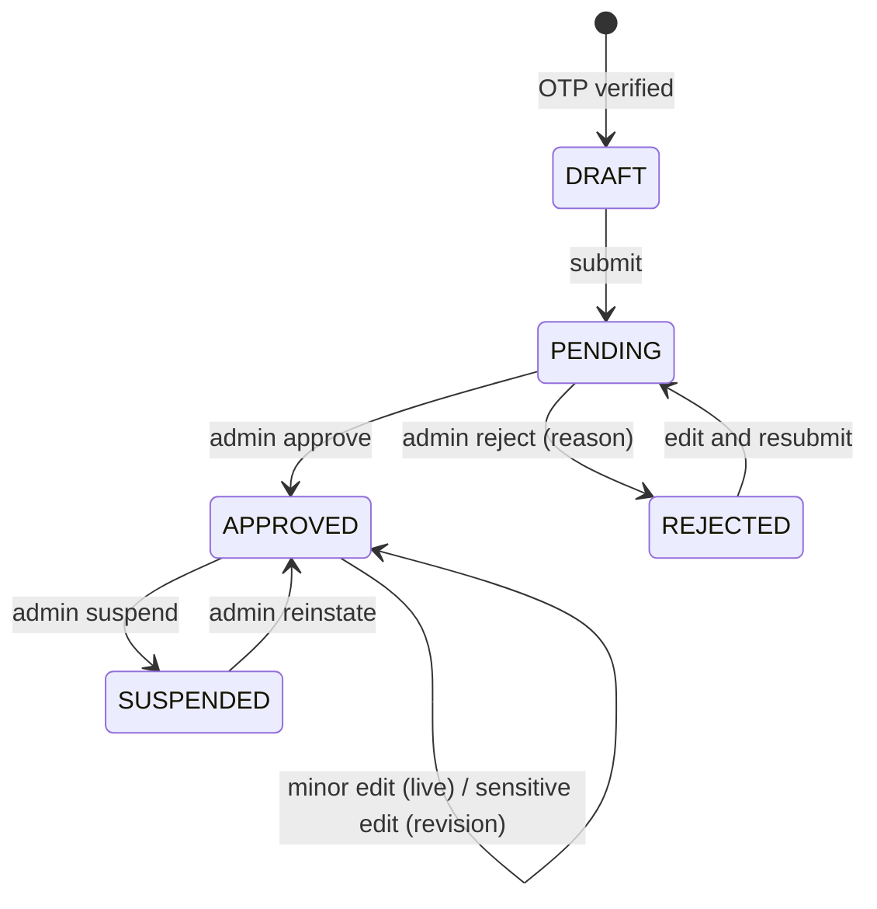
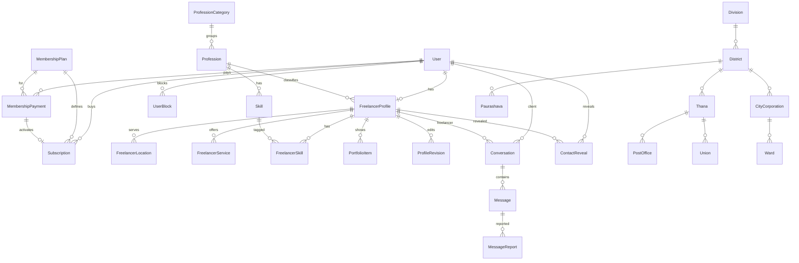
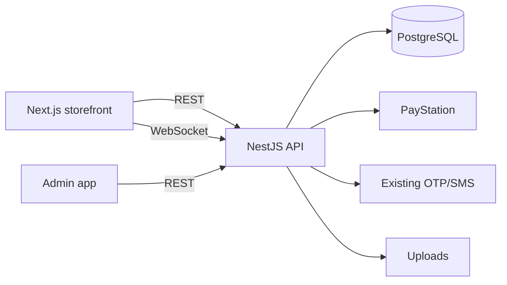

op# Freelancer Marketplace ("Hire a Professional") – Design

Status: design agreed through the grill-me interview (15 decisions). No code written yet.
Stack: NestJS + Prisma 7 (PostgreSQL) API (`apps/api`), Next.js storefront (`apps/web`), admin (`apps/admin`).

---

## 1. Decision Log

| # | Topic | Decision |
|---|-------|----------|
| 1 | Account model | Keep `User.role = CUSTOMER`. Add 1:1 `FreelancerProfile`. Freelancer capability = `status = APPROVED`. Freelancer phone = `User.phone` (unique among freelancers). A freelancer can also be a client. |
| 2 | Location model | Three nullable columns (`cityCorporationId`, `paurashavaId`, `unionId`), exactly one set. `upazilas` is renamed `paurashavas`. `wards` gets `cityCorporationId` + `wardNo` (number). |
| 3 | Location flow | Division → District → Thana → Post Office (always required), then an address-type button that decides what is shown (see 6.2). |
| 4 | Location storage | Full denormalized path on `FreelancerLocation`, validated for consistency on save. Up to 5 location rows per freelancer, one primary, one ward or union per row. |
| 5 | Membership access | Free browsing and profile viewing for logged-in customers. Active membership unlocks phone reveal, Call and Send Message. Single tier now. `features` JSON on plans for future tiers. |
| 6 | Payments | Separate `MembershipPayment` table. PayStation only. Server-side verification. Idempotent callbacks. Manual admin refunds in the MVP. Renewals stack. |
| 7 | Messaging transport | NestJS WebSocket (Socket.IO) gateway. Database is the source of truth. Send over REST, push over socket. Single API server (Redis adapter when scaling). Only active members start conversations. Freelancers can always reply. Members' messages are blocked after expiry. History stays readable. |
| 8 | Profile edits | Field-based review. Sensitive fields (name, photo, description, portfolio, profession) use a pending revision while the old data stays live. Minor fields (availability, price, skills, locations) apply instantly. Rejection needs a reason. Resubmission is unlimited. After 3 rejections the profile is flagged for manual review. |
| 9 | Phone privacy | Number is never in the profile payload. `POST reveal-phone` checks membership, applies a quota of 20 distinct freelancers per day (admin-configurable), and logs a `ContactReveal`. Re-revealing the same freelancer is free. Freelancers can see who revealed their number. |
| 10 | Spam and abuse | Layered controls: rate limits, report, block, admin actions, text-only messages, automatic filtering. Admin reads only reported conversations, and every read is audit-logged. Messages kept 2 years after the last activity. A suspended member's remaining time is decided by admin. |
| 11 | Auto filter | Bad words: blocked (both sides). Phone numbers and links: delivered but flagged (members only), and links are not clickable. 3 flags in a day lead to a 1-hour rate limit and an admin queue. Admin edits the word list, thresholds and toggles. |
| 12 | Taxonomy | Admin-managed `ProfessionCategory` → `Profession` → `Skill`, plus a freelancer suggestion queue. One profession per freelancer, up to 10 skills. Experience in integer years. Up to 10 services with a price type. |
| 13 | Scope of "hire" | Directory model (contact only). No in-platform job, escrow or dispute. Ratings and reviews are Phase 2. |
| 14 | Freelancer cost | Free to list. Paid "Featured" boost later (`featuredUntil` now). BUSY freelancers are shown with a grey badge. |
| 15 | Expiry | Access is decided by `expiresAt > now()` on every request, not by `status`. Reminders at 7, 3 and 1 days. Renewal is manual. No access during the grace window. Default for the rest below. |

Defaults chosen without further discussion (change if needed): Postgres filters plus `pg_trgm` search (no Elasticsearch), portfolio images through the existing uploads module (max 10), admin permissions via the existing `RoleDefinition`, notifications via the existing `Notification` table with new types.

---

## 2. Business Requirement Document (BRD)

**Goal:** add a paid-membership professional directory to the existing store without changing e-commerce behavior.

**Revenue:** member subscriptions (monthly 30 days, quarterly 90 days, yearly 365 days). Later: featured listings, ratings.

**Success metrics:** approved freelancers, membership conversion (free viewers → paid), renewal rate, conversations started per member, report rate.

**Scope**

| MVP | Later |
|-----|-------|
| Freelancer registration through OTP, profile, approval, revisions | Ratings and reviews |
| Membership plans, PayStation payment, expiry, reminders | Tiered plans (use `features` JSON) |
| Marketplace listing, filters, profile, reveal phone | Featured boost (paid) |
| Real-time messaging, report, block, auto filter | Masked relay phone numbers |
| Three dashboards, admin moderation, analytics | Multiple professions per freelancer |
| Bangladesh hierarchical location | Elasticsearch / geo search |
| | Auto-renewal (gateway-dependent) |

**Constraints:** reuse existing auth, OTP, uploads, notifications, audit log and PayStation integration. No change to Order, Payment or checkout tables.

---

## 3. Product Requirements (PRD) and Functional Requirements

### 3.1 Roles
- **Customer/Client**: existing `CUSTOMER`. Becomes a member by buying a plan.
- **Freelancer**: a customer with `FreelancerProfile`. Capability follows `status`.
- **Admin/Super Admin**: existing admin users with new marketplace permissions.

### 3.2 Freelancer registration
1. Customer taps "Become a Freelancer" and enters a mobile number (must match `User.phone`, or sets it if empty).
2. Existing OTP (`OtpCode`, purpose `FREELANCER_REGISTER`) verifies the number.
3. A `FreelancerProfile` is created as `DRAFT`.
4. Customer completes the profile: name, photo, email, address, profession, skills, years of experience, description, services and pricing, portfolio, availability, 1–5 locations.
5. Submit: validation, then `PENDING`.
6. Admin approves (`APPROVED`, `approvedAt`) or rejects (`REJECTED` with a mandatory reason). The freelancer edits and resubmits.

Validation: phone unique across freelancer profiles (verified, normalized to `+8801XXXXXXXXX`), one profile per user, required fields complete, at least one location and one service, photo type and size limits, consistent location path.

### 3.3 Status machine



### 3.4 Membership
- Plans: name, duration days, price (BDT), active flag, `features` JSON, sort order.
- Purchase creates `MembershipPayment(PENDING)` and a PayStation redirect. The callback is verified server-side and idempotent on `gatewayTxnId` and `idempotencyKey`.
- On `PAID`, a `Subscription` is created. If an active subscription exists, `startsAt = current.expiresAt` (stacking). Otherwise `startsAt = now`.
- Access check: `exists Subscription where userId and startsAt <= now < expiresAt and status != CANCELLED`.
- Nightly job: marks `EXPIRED`, sends reminders (7, 3, 1 days). The job is not trusted for access.
- Payment history is shown to the customer and to admin. Refunds are manual and recorded.

### 3.5 Marketplace
- Listing for logged-in customers (free). Card: photo, name, profession, top skills, experience, location, starting price, availability badge, View Profile, Send Message, Show number.
- Filters: category, profession, skills, experience range, price range, division, district, thana, address type, availability, text search.
- Sorting: default (Available first, last active, newest), price low/high, experience.
- Pagination: keyset/cursor, 20 per page.
- Visibility: `APPROVED`, `User.isActive`, at least one location and one service.

### 3.6 Messaging
- Customer: start a conversation (members only), send, history, unread counts, notifications.
- Freelancer: inbox, reply (always allowed unless blocked), unread count.
- Report and block. Filter on every send.

### 3.7 Admin
Freelancer management and approval, revision review, membership plans, subscriptions, payments, categories/professions/skills (including the suggestion queue), locations, message reports, user reports, analytics, bad-word list and thresholds.

---

## 4. Non-Functional Requirements

| Area | Requirement |
|------|-------------|
| Performance | Listing p95 under 300 ms at 50k freelancers. Message send p95 under 200 ms. Socket push under 1 s. |
| Scalability | Stateless API. A Redis adapter for sockets when scaling to more than one instance. Cursor pagination. |
| Security | JWT auth (existing). Role/permission guards. Ownership checks. Rate limits. Phone never in public payloads. Webhook verification. |
| Privacy | Contact data only through reveal. Reads of conversations only via reports, audit-logged. Retention 2 years. |
| Availability | A socket failure never loses a message (REST + DB first). |
| Maintainability | New Nest modules (`freelancers`, `memberships`, `messaging`, `marketplace-admin`), no edits to order/payment modules. |
| Audit | Admin actions and reveals logged (existing `AuditLog`). |
| Accessibility | Bangla and English labels (`bnName` already exist on location tables). |

---

## 5. User Journeys

**Client:** sign in → Hire a Professional → filter (Dhaka → Mirpur → Electrician) → view profile (phone masked) → "Buy a plan" → PayStation → active → Show number / Send Message → conversation → notifications.

**Freelancer:** Become a Freelancer → OTP → complete profile → submit → wait → approved → appears in the marketplace → receives messages → updates availability → sensitive edits go to revision.

**Admin:** reviews the pending queue → opens a profile → approve or reject with a reason → reviews revisions (diff) → handles reports → manages plans, taxonomy, locations.

---

## 6. Data Model

### 6.1 ER diagram



### 6.2 Location

Existing: `divisions`, `districts` (division), `thanas` (district), `unions` (thana), `city_corporations` (district).

Changes:
- Rename `upazilas` → `paurashavas`. Keep `districtId`, make it required after data check.
- `wards`: add `cityCorporationId` (FK), `wardNo` (Int), unique `(cityCorporationId, wardNo)`. Import the data.
- New `post_offices` imported from `apps/api/prisma/post_offices.sql` (MariaDB dump): `id`, `name`, `bnName`, `postalCode`, `status`, `thanaId` FK. Convert the invalid `0000-00-00` timestamps to NULL.

Cascading UI:

| Type selected | Shown | Hidden |
|---|---|---|
| City Corporation | City Corporation list (by district), Ward list (by city corporation) | Paurashava, Union |
| Paurashava | Paurashava list (by district) | City Corporation, Union, Ward |
| Union | Union list (by thana) | City Corporation, Paurashava, Ward |

Division, District, Thana and Post Office are always required.

`FreelancerLocation`

| Column | Type | Notes |
|---|---|---|
| id | uuid | PK |
| freelancerId | uuid | FK, index |
| divisionId, districtId, thanaId, postOfficeId | int | required, denormalized |
| cityCorporationId, wardId | int? | set together |
| paurashavaId | int? | |
| unionId | int? | |
| localityText | varchar(100)? | optional free text |
| isPrimary | bool | exactly one per freelancer |

Constraints: check that exactly one of (`cityCorporationId`, `paurashavaId`, `unionId`) is set. `wardId` only with `cityCorporationId`. The service validates: PostOffice.thana = thanaId, Thana.district = districtId, District.division = divisionId, the type-column's parent matches the district or thana. Max 5 rows per freelancer.
Indexes: `(divisionId)`, `(districtId)`, `(thanaId)`, `(postOfficeId)`, `(cityCorporationId, wardId)`, `(paurashavaId)`, `(unionId)`.

### 6.3 Core tables

`FreelancerProfile`: id, userId (unique FK), status (`DRAFT|PENDING|APPROVED|REJECTED|SUSPENDED`), displayName, photoUrl, professionId, title, about, experienceYears, email, address, availability (`AVAILABLE|BUSY|UNAVAILABLE`), startingPrice (cached int), rejectionReason, rejectionCount, approvedAt, approvedById, suspendedAt, suspendReason, featuredUntil, lastActiveAt, createdAt, updatedAt.
Indexes: `(status, professionId)`, `(status, availability)`, `(startingPrice)`, `(experienceYears)`, trigram on `displayName`/`title`.

`FreelancerService`: id, freelancerId, title, description, priceType (`FIXED|HOURLY|DAILY|NEGOTIABLE`), amount (int BDT, nullable for NEGOTIABLE). Max 10.
`FreelancerSkill`: freelancerId, skillId (composite PK). Max 10.
`PortfolioItem`: id, freelancerId, imageUrl, caption, sortOrder. Max 10.
`ProfileRevision`: id, freelancerId, payload JSON (sensitive fields), status (`PENDING|APPROVED|REJECTED`), reviewedById, reason, createdAt.
`ProfessionCategory`, `Profession`, `Skill` (status `ACTIVE|PENDING|REJECTED`, `suggestedById`, `mergedIntoId`).

`MembershipPlan`: id, name, durationDays, price, features JSON, isActive, sortOrder.
`MembershipPayment`: id, userId, planId, amount, gateway, gatewayTxnId (unique), idempotencyKey (unique), status (`PENDING|PAID|FAILED|CANCELLED|REFUNDED`), rawPayload JSON, paidAt, refundedById, createdAt.
`Subscription`: id, userId, planId, paymentId (unique), startsAt, expiresAt, status (`ACTIVE|EXPIRED|CANCELLED`), cancelledReason. Index `(userId, expiresAt)`.

`Conversation`: id, clientId (User), freelancerId (FreelancerProfile), lastMessageAt, clientUnread, freelancerUnread, status (`OPEN|CLOSED`), unique `(clientId, freelancerId)`.
`Message`: id, conversationId, senderId, body (text, max 2000), flags (`PHONE|LINK`), readAt, createdAt. Index `(conversationId, createdAt)`.
`MessageReport`: id, messageId?, conversationId, reporterId, reason, status, reviewedById, createdAt.
`UserBlock`: blockerId, blockedId (composite PK).
`ContactReveal`: id, userId, freelancerId, createdAt. Index `(userId, createdAt)`.
`FilterTerm`: id, term, language, active. Settings in the existing settings module.

`Notification`: add types `FREELANCER_APPROVED`, `FREELANCER_REJECTED`, `REVISION_RESULT`, `MESSAGE_NEW`, `MEMBERSHIP_EXPIRING`, `MEMBERSHIP_EXPIRED`, `REPORT_UPDATE`.

---

## 7. System Architecture



New modules inside `apps/api/src`: `freelancers`, `marketplace` (search), `memberships` (plans, payments, subscriptions, expiry cron), `messaging` (REST and gateway), `taxonomy`, `moderation`. Existing: auth, users, locations, notifications, audit-logs, payments (PayStation client reused), settings.

Guards: `JwtAuthGuard`, `PermissionsGuard` (admin), `FreelancerGuard` (status approved), `MembershipGuard` (active subscription).

---

## 8. API Endpoints (prefix `/api`)

**Public/customer**
- `GET /locations/divisions|districts|thanas|post-offices|city-corporations|paurashavas|unions|wards` (filtered by the parent query parameter)
- `GET /marketplace/freelancers` (filters, sort, cursor)
- `GET /marketplace/freelancers/:id` (public profile, no phone/email)
- `POST /marketplace/freelancers/:id/reveal-phone` (membership, quota)
- `GET /memberships/plans`
- `POST /memberships/checkout`, `GET /memberships/callback`, `GET /memberships/me`, `GET /memberships/history`
- `GET /taxonomy/categories|professions|skills`
- `POST /conversations` (membership), `GET /conversations`, `GET /conversations/:id/messages`
- `POST /conversations/:id/messages`, `POST /conversations/:id/read`
- `POST /conversations/:id/report`, `POST /users/:id/block`, `DELETE /users/:id/block`
- WebSocket events: `message:new`, `unread:update`

**Freelancer**
- `POST /freelancer/register/otp`, `POST /freelancer/register/verify`
- `GET|PUT /freelancer/profile`, `POST /freelancer/profile/submit`
- `GET|PUT /freelancer/services|skills|locations|portfolio|availability`
- `POST /freelancer/skills/suggest`
- `GET /freelancer/reveals`, `GET /freelancer/dashboard`

**Admin** (permission-guarded)
- `GET /admin/freelancers`, `POST /admin/freelancers/:id/approve|reject|suspend|reinstate`
- `GET /admin/revisions`, `POST /admin/revisions/:id/approve|reject`
- CRUD: `/admin/plans`, `/admin/categories`, `/admin/professions`, `/admin/skills` (plus the suggestion queue), `/admin/locations/*`, `/admin/filter-terms`
- `GET /admin/subscriptions`, `GET /admin/payments`, `POST /admin/payments/:id/refund`
- `GET /admin/reports`, `GET /admin/reports/:id/conversation` (audit-logged), `POST /admin/reports/:id/action`
- `GET /admin/analytics`

---

## 9. Subscription and Payment Logic

```
checkout → MembershipPayment(PENDING, idempotencyKey)
callback → verify with PayStation API (amount, status, txn id)
  if PAID and not already processed (unique gatewayTxnId):
     tx: payment.status = PAID
         start = max(now, latest active subscription.expiresAt)
         Subscription(start, start + plan.durationDays)
     notify user
  else mark FAILED
```

- Amount is taken from the plan on the server, never from the client.
- A duplicate callback does nothing.
- Renewal while active stacks. Renewal after expiry starts from now.
- Reminders at 7, 3, 1 days. After expiry access is off at once. The 2-day grace window protects the plan price only. It gives no access.
- Suspended member: remaining time is handled by admin (refund, forfeit or reinstate).

---

## 10. Search and Filtering

```
WHERE profile.status = 'APPROVED' AND user.isActive
  AND EXISTS location AND EXISTS service
  [AND professionId / categoryId]
  [AND skills ALL/ANY of given]
  [AND experienceYears BETWEEN]
  [AND startingPrice BETWEEN]
  [AND location.divisionId / districtId / thanaId / type column]
  [AND availability IN (...)]
  [AND (displayName/title ILIKE or trigram similarity)]
ORDER BY availability_rank, lastActiveAt DESC, createdAt DESC   -- default
```

Cursor pagination on `(sortKey, id)`. Counts per profession are cached for a short time. `startingPrice` is a cached column, updated whenever services change.

---

## 11. Messaging Architecture

- Send: `POST /conversations/:id/messages` → check membership (for members), blocks, rate limits, filter → save → update unread counts → emit `message:new` to the recipient room → create a `Notification` if the recipient is offline.
- The socket authenticates with the JWT at connect and joins `user:{id}`.
- The client reconnects and syncs through `GET .../messages?after=<id>`.
- Rate limits: 20 new conversations per day per member, 30 messages per minute per user.
- Filter: bad words blocked, phone and links flagged (members), 3 flags per day triggers a 1-hour limit and an admin queue entry.
- Reports: admin can read a reported conversation only (last 50 messages), audit-logged.
- Retention: 2 years after the last activity, then archive.

---

## 12. Dashboards and UI Structure

**Customer:** My Membership, Membership History, Hire a Professional (filters, cards, profile), My Conversations, Notifications.
**Freelancer:** Overview, My Profile, My Services, My Skills, My Location (the cascading selector in section 6.2), Messages/Inbox, Notifications, Availability, Approval Status (including revisions and rejection reason), Who Viewed My Number, Account Settings.
**Admin:** Freelancer Management, Approvals and Revisions, Membership Plans, Subscriptions, Payments, Categories/Professions, Skills (and suggestions), Locations, Message Reports, User Reports, Filter Settings, Marketplace Analytics.

---

## 13. Security and Authorization

- Customer actions need JWT. Freelancer actions need an owned profile. Membership-gated actions use `MembershipGuard`. Admin actions need explicit permissions through `RoleDefinition` (for example `freelancers.approve`, `plans.manage`, `reports.review`).
- Every query that returns freelancer data uses a public DTO without phone, email or address.
- IDOR checks on conversations (participants only) and revisions.
- Upload checks for photo and portfolio (type, size, re-encoding).
- Rate limits on OTP, reveal, message and report endpoints.
- Webhook/callback verification and idempotency.
- Audit log for approvals, suspensions, refunds, reveals and report reads.

---

## 14. Development Phases

| Phase | Content |
|---|---|
| 0 | Location cleanup: rename `upazilas`, `wards` parent and number, import `post_offices`, consistency validation, cascading UI. |
| 1 | Taxonomy, `FreelancerProfile`, registration with OTP, profile editing, admin approval and revisions. |
| 2 | Plans, PayStation checkout, subscriptions, access guards, expiry job and reminders. |
| 3 | Marketplace listing, filters, profile page, reveal phone. |
| 4 | Messaging (REST, gateway, notifications), reports, blocks, filter. |
| 5 | Dashboards polish, analytics, hardening, load test. |
| Later | Reviews, tiers, featured boost, masked numbers, Elasticsearch. |

---

## 15. Testing and Acceptance

| Area | Scenario | Expected |
|---|---|---|
| Registration | Same phone registers twice | Second is rejected (unique). |
| Registration | Submit without a location | Validation error. |
| Location | Post Office from another Thana | Rejected by the consistency check. |
| Location | Type = Union | City Corporation, Paurashava and Ward are not accepted. |
| Approval | Reject without a reason | Rejected with a validation error. |
| Revision | Change photo on an approved profile | Old photo stays public until approval. |
| Revision | Change price | Live at once. |
| Membership | Callback sent twice | One subscription only. |
| Membership | Renew with 10 days left | New term starts when the current term ends. |
| Membership | `expiresAt` passed, job not run | Access is already denied. |
| Access | No membership clicks Send Message | `403` with a "buy a plan" message. |
| Phone | Profile payload | Contains no phone number. |
| Phone | Reveal #21 on the same day | `429`. Re-revealing a known freelancer works. |
| Messaging | Freelancer replies after the member's plan expired | Allowed. Member's new message is blocked. |
| Messaging | Blocked user sends | Rejected. |
| Filter | Bad word | Blocked. |
| Filter | Phone number from a member | Delivered, flagged. |
| Visibility | Suspended freelancer | Hidden from the listing, reveal blocked. |
| Existing | Order, checkout and payment flows | Unchanged (regression tests). |

Acceptance for MVP: all scenarios pass, listing p95 under 300 ms on seeded data, no existing e2e test regresses.

---

## 16. Open Items

- Final ward data source and import.
- Bad-word list (English and Bangla) content.
- Plan prices (examples used: 299 / 799 / 2,499 BDT).
- Exact SMS reminder support in the SMS provider.

