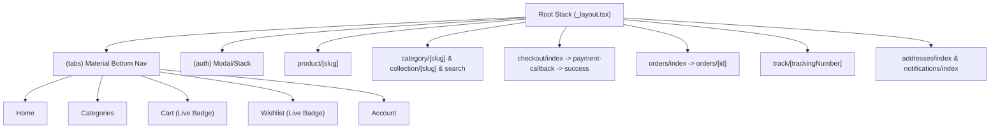
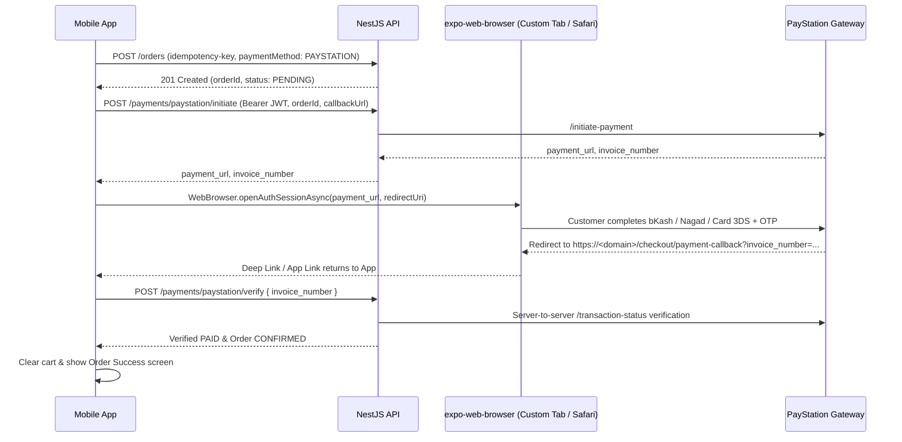

# A to Z Ecommerce — Production React Native Mobile App Design Blueprint

**Project:** A to Z Ecommerce (`az-ecommerce` Monorepo)  
**Target Workspace:** `apps/mobile` (+ shared `packages/api-client`)  
**Backend:** `apps/api` (NestJS 12 + Prisma 7 + PostgreSQL + Swagger/OpenAPI)  
**Status:** Approved via Structured Architectural Interview (17/17 Decisions Finalized)  
**Date:** 2026-11-22  

---

## Table of Contents

1. [Executive Summary & Existing Project Analysis](#1-executive-summary--existing-project-analysis)
2. [Finalized Interview Decision Matrix](#2-finalized-interview-decision-matrix)
3. [Installed Skills Analysis & Task Mapping](#3-installed-skills-analysis--task-mapping)
4. [Monorepo Placement, Expo Foundation & Architecture](#4-monorepo-placement-expo-foundation--architecture)
5. [Platform Support & Device Baseline (Android / iOS)](#5-platform-support--device-baseline-android--ios)
6. [UI/UX & Material Design 3 System](#6-uiux--material-design-3-system)
7. [Navigation, Protected Routes & Deep Linking](#7-navigation-protected-routes--deep-linking)
8. [Authentication, JWT Lifecycle & Secure Storage](#8-authentication-jwt-lifecycle--secure-storage)
9. [API Integration, State & Cache Architecture](#9-api-integration-state--cache-architecture)
10. [Catalog, Search, Filters, Sorting & Variants](#10-catalog-search-filters-sorting--variants)
11. [Wishlist & Hybrid Server-Synced Cart](#11-wishlist--hybrid-server-synced-cart)
12. [Checkout, Coupons, Shipping & Payments (COD / PayStation)](#12-checkout-coupons-shipping--payments-cod--paystation)
13. [Order History, Details, Tracking & Invoice Receipt](#13-order-history-details-tracking--invoice-receipt)
14. [Push Notifications Architecture](#14-push-notifications-architecture)
15. [Image Optimization, Performance & Resilience States](#15-image-optimization-performance--resilience-states)
16. [Security & Accessibility Standards](#16-security--accessibility-standards)
17. [Crash Monitoring & E-commerce Funnel Analytics](#17-crash-monitoring--e-commerce-funnel-analytics)
18. [Testing Strategy (Static, RNTL & Maestro E2E)](#18-testing-strategy-static-rntl--maestro-e2e)
19. [Environments, Versioning, OTA Updates & Store Release](#19-environments-versioning-ota-updates--store-release)
20. [Required Backend Upgrades (`apps/api`)](#20-required-backend-upgrades-appsapi)
21. [Phased Implementation Roadmap](#21-phased-implementation-roadmap)

---

## 1. Executive Summary & Existing Project Analysis

A full audit of the existing `A2Z-Ecommerce` repository established the real ground truth that drives every architectural decision in this document:

### 1.1 Existing Stack (Verified in Codebase)
- **Monorepo:** Turborepo (`turbo@^2.11.7`) + `pnpm@11.25.0`, Node `>=24`, TypeScript `^6.0.3`.
  - `apps/api`: **NestJS 12** + Express 5 + Prisma 7 (`@prisma/adapter-pg`) + PostgreSQL + Swagger (`/api/docs`, `/api/docs-json`) + Socket.IO (`/messaging`). *(Note: Despite the parent folder name `d:\laravel\...`, this is a TypeScript/NestJS backend, not Laravel.)*
  - `apps/web`: Next.js 16.3.8 + React 19.2.8 + Tailwind CSS v4 (React Context + `localStorage` state; no Zustand or TanStack Query yet).
  - `apps/admin`: Next.js 16.3.8 + AdminLTE 4 / Bootstrap 5.
  - `packages/*`: `@repo/eslint-config`, `@repo/typescript-config`, `@repo/ui` (starter stub only).
- **Existing E-commerce Backend Capabilities (`/api/v1`):**
  - **Auth:** BD Phone + 4-digit MobiReach SMS OTP (`/auth/phone/*`) AND Email/Password (`/auth/register`, `/auth/login`). Returns `accessToken` (`15m`) and `refreshToken` (`7d`) in JSON response body AND sets an `HttpOnly` cookie. `POST /auth/refresh` accepts `{ refreshToken }` in JSON body (mobile-ready without cookies).
  - **Catalog:** `GET /products` (paginated with `facets`, `sortBy`, multi-filters), `GET /products/curated`, `GET /products/search-suggestions`, `GET /products/:slug` (variants with `TEXT`/`COLOR`/`BUTTON` attributes & `colorCode`, specs, warranty, reviews), `/categories/tree`, `/brands`, `/collections/home`, `/settings/public`.
  - **Wishlist:** Full server sync (`/wishlist`, `/wishlist/sync`, `/wishlist/guest-items`).
  - **Checkout & Coupons:** Authoritative `POST /checkout/calculate`, `GET /coupons/active`, `POST /coupons/validate`.
  - **Shipping & Locations:** Full Bangladesh cascade (`/locations/divisions`, `districts`, `thanas`, `post-offices`, etc. with `name` + `bnName`), `/shipping/zones`, `/shipping/methods`.
  - **Orders & Tracking:** Authenticated `POST /orders` (supports `idempotency-key` header), `GET /orders`, `GET /orders/:id`, `POST /orders/:id/cancel` (strictly `PENDING`), `GET /orders/:orderId/shipments`, public `GET /shipments/track/:trackingNumber`.
  - **Payments:** `GET /payments/methods/active` (`CASH_ON_DELIVERY`, `PAYSTATION`, `MOBILE_BANKING`, etc.) and PayStation hosted gateway (`/payments/paystation/initiate`, `/verify`, `/status/:invoiceNumber`).
  - **In-App Notifications:** `GET /notifications/my`, `/unread-count`, `/mark-all-read`, `/:id/read`.
  - **Secondary Domain in Backend:** Freelancer Marketplace, Memberships, and Socket.IO Messaging exist in `apps/api` — explicitly **deferred to v2** for the mobile app.

### 1.2 Critical Gaps & Risks Identified in Codebase Audit
| Area | Current State in `apps/api` | Impact on Production Mobile App | Planned Resolution |
|---|---|---|---|
| **Server Cart** | No `Cart` / `CartItem` model or `/cart` endpoints | Cart would not sync across Web & Mobile or survive reinstall | Add `Cart`/`CartItem` + `/cart` & `/cart/sync` (Section 11 & 20) |
| **Multi-Device Logout** | `User.tokenVersion` revokes ALL devices on logout | Logging out on mobile logs out web browser too | Add per-device `RefreshSession` table (Section 8 & 20) |
| **Push Notifications** | In-app DB `Notification` only; no `DeviceToken` or FCM/APNs | No real-time order/delivery/promo push alerts | Add `DeviceToken` + `expo-server-sdk` dispatch (Section 14 & 20) |
| **PayStation Auth Guard** | `POST /payments/paystation/initiate` has no `JwtAuthGuard` | Unauthorized initiation risk; no server-side IPN webhook for store orders | Add `JwtAuthGuard` + order ownership check + IPN webhook (Section 12 & 20) |
| **Rate Limiting & Dev Secrets** | No `@nestjs/throttler` on `send-otp`/auth; hardcoded dev fallbacks & `customer@az-ecommerce.local` backdoor | SMS billing abuse & production credential exposure risk | Add `@nestjs/throttler`, block dev fallbacks/backdoors when `NODE_ENV=production` (Section 16 & 20) |
| **Image Optimization** | Local disk raw PNG/JPG up to 5 MB; no resize/WebP/CDN | Slow 4G load & OOM risk on 3 GB RAM BD Android phones | Backend `sharp` WebP/thumbnail pipeline + mobile `expo-image` caching (Section 15 & 20) |
| **Pagination Envelope Drift** | `/products` & `/notifications` return `{ items, total, page, limit, totalPages }`; `/orders` returns `{ data, meta }` | Client list hooks break if assuming one shape | Normalize via Orval response adapters in `packages/api-client` (Section 9) |
| **OpenAPI DTO Gaps** | `Auth`, `AccountAddresses`, `Collections`, `Settings` miss `@ApiResponse({ type })` | Orval emits `void`/`unknown` return types | Complete Swagger `@ApiResponse` DTOs in `apps/api` (Section 9 & 20) |
| **Apple App Store Deletion** | No self-service account deletion endpoint | Mandatory iOS App Store rejection | Add `DELETE /account` / anonymization flow (Section 8 & 20) |

---

## 2. Finalized Interview Decision Matrix

| # | Domain / Topic | Approved Decision |
|---|---|---|
| 1 | **v1 App Scope** | **E-commerce Customer Shopping App only** (modular architecture ready to plug in `features/freelancers` & chat in v2). |
| 2 | **Framework** | **Expo (CNG / Prebuild + Development Client + EAS)** with React Native New Architecture enabled. |
| 3 | **Platform Support & Launch** | **Cross-platform first (Android 9+ / API 28+, iOS 15.1+)**; **Android-first store release**, followed by **iOS via EAS Cloud Build + TestFlight** (building from Windows). |
| 4 | **Repo & Architecture** | Inside existing monorepo at **`apps/mobile`** + shared **`packages/api-client`**; **Feature-Based Modular Architecture** (`src/app/` thin routes + `src/features/*` + `src/shared/*`). |
| 5 | **UI/UX, Design System & Currency** | **`react-native-paper` v5 (Material Design 3)** + AZ Brand Theme (`#1D4ED8`, `#0F172A`, `#EA580C`, `#F8FAFC`) + `@gorhom/bottom-sheet` + Light-first (Dark-ready tokens) + **EN & BN (`i18next`, `Inter` + `Hind Siliguri`)** + **`BDT`** price prefix (South Asian grouping, e.g., `BDT 1,25,000`). |
| 6 | **Navigation & Protected Routes** | **Expo Router** with **5 bottom tabs** (`Home`, `Categories`, `Cart` with badge, `Wishlist`, `Account`), separate Stack routes for PDP/Search/Checkout/Orders, **Guest-friendly browsing**, Auth Guard with automatic return-redirect. |
| 7 | **Auth, JWT & Secure Storage** | **Phone-First UX** (MobiReach 4-digit OTP / password + Email fallback), **`expo-secure-store`** for refresh token, in-memory access token + Single-Flight 401 Refresh Queue, backend **Per-Device `RefreshSession`**, OTP rate limiting & Account Delete API. |
| 8 | **API, State & Caching** | **Orval** (from NestJS `/api/docs-json` + custom JWT mutator) + **TanStack Query v5** (with selective **MMKV** persister) + **Zustand + MMKV** (client state only) + **React Hook Form + Zod**. |
| 9 | **Cart Sync & Wishlist** | **Hybrid Server-Synced Cart** (guest MMKV + new `/cart` & `/cart/sync` on backend + `/checkout/calculate` live validation) + existing **Wishlist Sync** (`/wishlist/sync`, `/wishlist/guest-items`) with optimistic UI. |
| 10 | **Catalog, Search, Filters & Variants** | `@shopify/flash-list` 2-col infinite grid, 300ms debounced Search + MMKV Recent Searches, Material 3 Faceted Filter/Sort Bottom Sheet, PDP swatches/chips/stock + sticky `Add to Cart`/`Buy Now`, **Smart Quick-Add / Variant Bottom Sheet** on cards. |
| 11 | **Checkout, Coupons, Shipping & Payments** | Clean **1-page scrollable checkout**, saved address / BD cascade, dynamic shipping methods, Available Coupons sheet, `idempotency-key` UUID on `POST /orders`, **COD + PayStation via `expo-web-browser` (Custom Tab/Safari) + Deep Link callback + mandatory `POST /payments/paystation/verify`** + Pending Retry + PayStation auth guard fix. |
| 12 | **Orders, Tracking & Invoice** | Status-filtered Order History, Visual Stepper Timeline (`statusHistory` + courier tracking), Public Track screen, Cancel (`PENDING`), Pay Now/Verify, Write Review (`DELIVERED`), 1-Tap Reorder, client-side PDF Receipt via **`expo-print` + `expo-sharing`**. |
| 13 | **Push Notifications & Deep Linking** | **`expo-notifications` + Expo Push Service (FCM v1 + APNs)** + backend `DeviceToken` table + `expo-server-sdk`, **HTTPS App Links / Universal Links + `azecommerce://`**, contextual permission prompt. |
| 14 | **Images, Performance & Offline/Network** | Mobile **`expo-image`** (memory-disk cache, `recyclingKey`, URL normalizer) + backend `sharp` auto **WebP/Thumbnails** (`400px`/`800px`, CDN-ready) + Skeleton/Empty/Error Boundary + `NetInfo` + TanStack Query `onlineManager` offline mode & safe retry matrix. |
| 15 | **Security, Accessibility & Analytics** | Mobile + Backend security hardening, WCAG AA + Material 3 accessibility (`48dp` targets, `#C2410C` safe contrast, Bangla line-height ≥ 1.6, Reduced Motion), **`@sentry/react-native`** + **PostHog React Native** behind `analytics` abstraction. |
| 16 | **Testing Strategy** | **3-Layer Pyramid:** Static (`tsc` + ESLint) + **Jest & RNTL** (logic & components) + **Maestro E2E YAML** (5 critical flows with `testID` standard). |
| 17 | **Envs, Versioning, OTA & Store Release** | **3 Environments (`dev` / `staging` / `prod`)** with side-by-side Bundle IDs (`app.config.ts` + Zod), SemVer + EAS `autoIncrement`, `runtimeVersion: appVersion`, Remote Soft/Force Update (`GET /settings/public`), **EAS Build / Update / Submit + `.eas/workflows/` CI/CD**. |

---

## 3. Installed Skills Analysis & Task Mapping

All **35 skills** installed in `C:\Users\ripon\.agents\skills` were audited and mapped to exact responsibilities across the mobile app lifecycle.

### 3.1 Mobile App Skills — Task-to-Skill Matrix

| Phase / Workstream | Primary Skill(s) to Invoke | Supporting Skill(s) | Exact Tasks & Responsibilities |
|---|---|---|---|
| **1. Project Bootstrap & Folder Layout** | `expo-project-structure`, `react-native-architecture` | `expo-dev-client` | Scaffold `apps/mobile` inside Turborepo, configure `metro.config.js` for pnpm monorepo, set up `src/app/` + `src/features/*` + `src/shared/*`, configure Expo New Architecture & Dev Client plugins. |
| **2. Navigation & Deep Linking** | `expo-router` | `react-native-architecture` | Configure 5 bottom tabs (`(tabs)`), root Stack/Modal screens, `(auth)` group with return-redirect guard, Android App Links (`intentFilters`), iOS Universal Links (`associatedDomains`), and `azecommerce://` deep link handlers. |
| **3. Material Design 3 UI & Theme** | `expo-design-system`, `ui-ux-pro-max` | `expo-native-ui`, `frontend-design` | Build AZ MD3 theme (`react-native-paper` v5) with brand tokens (`#1D4ED8`, `#0F172A`, `#EA580C`), typography (`Inter` + `Hind Siliguri`), spacing/elevation scales, `BDT` formatting components, WCAG AA contrast & `48dp` touch targets. |
| **4. Gestures, Sheets & Micro-Interactions** | `animate-expo` | `expo-native-ui` | Implement UI-thread Reanimated animations, `@gorhom/bottom-sheet` (Filter Sheet, Variant Quick-Add Sheet, Coupon Sheet, Address Picker), press haptics (`expo-haptics`), carousel zoom, and `prefers-reduced-motion` degradation. |
| **5. API Client & Contract Generation** | `orval`, `expo-data-fetching` | `zod` | Generate type-safe API functions, TypeScript DTOs, and TanStack Query hooks into `packages/api-client` from `http://localhost:3001/api/docs-json`; build custom HTTP mutator with JWT Bearer injection, error normalization, and timeout handling. |
| **6. Server State & Offline Caching** | `tanstack-query-best-practices` | `react-native-mmkv`, `expo-data-fetching` | Configure QueryClient, query key factories, infinite scrolling (`useInfiniteQuery`) for catalog/orders, optimistic wishlist/cart mutations, `NetInfo` `onlineManager`, and selective MMKV persistence. |
| **7. Local State & High-Speed Storage** | `zustand`, `react-native-mmkv` | `zod` | Implement state-only Zustand stores (`cartStore`, `preferencesStore`, `recentSearchStore`, `authSessionStore`) backed by synchronous MMKV storage (strictly excluding raw JWT secrets). |
| **8. Forms & Schema Validation** | `react-hook-form`, `zod` | `expo-design-system` | Build performant forms with minimal re-renders: Phone/OTP Auth, Email Auth, BD Cascading Address form, Checkout & Coupon input, Manual MFS TrxID form, Product Review form, and runtime `app.config.ts` / deep link parameter Zod validation. |
| **9. Authentication, JWT & Security** | `auth-implementation-patterns`, `security-review` | `expo-router` | Implement `expo-secure-store` refresh token storage, in-memory access token, Single-Flight 401 refresh lock/queue, auth route protection, PayStation callback verification, HTTPS-only ATS/Network Security Config, and pre-release OWASP mobile + API security audit. |
| **10. Backend Mobile Upgrades (`apps/api`)** | `api-designer`, `database-optimizer` | `auth-implementation-patterns`, `security-review` | Design & optimize Prisma models/indexes and NestJS endpoints for `Cart`/`CartItem`, `RefreshSession`, `DeviceToken` (Expo Push), Account Deletion, `PaystationController` auth guard + IPN webhook, `sharp` WebP uploads, and `@nestjs/throttler`. |
| **11. Performance & Image Optimization** | `react-native-best-practices`, `vercel-react-native-skills` | `expo-native-ui` | Optimize Hermes startup TTI, `@shopify/flash-list` recycling & `estimatedItemSize`, `expo-image` disk/memory caching & `recyclingKey`, bundle size checks, and 60 FPS scroll profiling on 3 GB RAM Android devices. |
| **12. Crash Reporting & Observability** | `sentry-sdk-setup` | `eas-update` | Install and configure `@sentry/react-native` with source maps upload for both native EAS Builds and EAS Updates, navigation performance tracing, release health tracking, and PII scrubbing. |
| **13. Unit & Component Testing** | `react-native-testing` | `zod` | Write Jest + RNTL (`@testing-library/react-native`) tests for `formatBDT`, 401 refresh lock, cart merge logic, variant availability resolver, and critical UI components (`ProductCard`, `VariantSheet`, `CheckoutSummary`, `OtpForm`). |
| **14. End-to-End Mobile Testing** | `maestro-mobile-testing` | `react-native-testing` | Author cross-platform Maestro YAML E2E flows (`testID`-driven) for Auth/OTP, Browse/Filter/Variant, Guest→Auth Cart/Wishlist Sync, COD Checkout & Cancel, and PayStation Sandbox & Order Tracking. |
| **15. Dev Builds, OTA, CI/CD & Store Release** | `expo-dev-client`, `eas-app-stores`, `eas-update`, `eas-workflows` | `sentry-sdk-setup` | Configure `eas.json` (`development`, `staging`, `production`), internal dev client distribution, OTA channels/branches (`runtimeVersion: appVersion`), Play Store `.aab` staged rollouts, iOS Cloud Build → TestFlight → App Store submission, and `.eas/workflows/` automation. |

### 3.2 Installed Skills Explicitly Out of Scope for `apps/mobile`

| Installed Skill | Reason Not Used for `apps/mobile` |
|---|---|
| `laravel-best-practices`, `laravel-security`, `laravel-specialist` | Repository backend (`apps/api`) is **NestJS 12 + Prisma + PostgreSQL**, not Laravel PHP. |
| `vercel-react-best-practices`, `web-design-guidelines` | Specific to Next.js / web DOM apps (`apps/web`, `apps/admin`), not React Native. |
| `grill-me`, `find-skills` | Meta / workflow discovery skills (already used for this design interview). |

---

## 4. Monorepo Placement, Expo Foundation & Architecture

### 4.1 Why Expo (CNG / Prebuild + Dev Client + EAS)
- **Continuous Native Generation (CNG):** `android/` and `ios/` directories are generated deterministically via `expo prebuild` from `app.config.ts` and config plugins — eliminating manual Gradle/Xcode/CocoaPods merge drift during React Native upgrades.
- **Full Native Capabilities:** Custom Development Client (`expo-dev-client`) enables `react-native-mmkv` (Nitro/JSI), `expo-secure-store`, `expo-notifications`, `expo-image`, `@sentry/react-native`, and `@shopify/flash-list` with **New Architecture** enabled.
- **Instant Hotfixes:** `EAS Update` ships critical JS/asset fixes in minutes without waiting 2–5 days for Google Play / Apple App Store review.
- **Windows-Friendly iOS Builds:** Because development happens on **Windows**, `EAS Build` compiles signed iOS `.ipa` artifacts in the cloud and submits directly to TestFlight.

### 4.2 Turborepo + `pnpm` Monorepo Strategy (`apps/mobile`)
```text
A2Z-Ecommerce/
├── apps/
│   ├── api/                        # Existing NestJS 12 + Prisma backend
│   ├── web/                        # Existing Next.js 16 storefront
│   ├── admin/                      # Existing Next.js 16 admin panel
│   └── mobile/                     # NEW: Expo React Native App
│       ├── app.config.ts           # Dynamic env-aware Expo config (dev/staging/prod)
│       ├── eas.json                # EAS Build & Submit profiles
│       ├── metro.config.js         # Monorepo watchFolders + pnpm resolution
│       ├── .eas/workflows/         # CI/CD pipelines (PR check, staging, prod)
│       ├── maestro/                # E2E YAML test flows
│       └── src/
│           ├── app/                # Thin Expo Router screens ONLY (no business logic)
│           │   ├── _layout.tsx     # Root providers (Paper, Query, Gesture, Sentry, Auth)
│           │   ├── (tabs)/
│           │   │   ├── _layout.tsx # 5-tab Material bottom navigation
│           │   │   ├── index.tsx   # Home
│           │   │   ├── categories.tsx
│           │   │   ├── cart.tsx
│           │   │   ├── wishlist.tsx
│           │   │   └── account.tsx
│           │   ├── (auth)/
│           │   │   ├── login.tsx
│           │   │   ├── otp.tsx
│           │   │   ├── register.tsx
│           │   │   └── forgot-password.tsx
│           │   ├── product/[slug].tsx
│           │   ├── category/[slug].tsx
│           │   ├── collection/[slug].tsx
│           │   ├── search.tsx
│           │   ├── checkout/
│           │   │   ├── index.tsx
│           │   │   ├── payment-callback.tsx
│           │   │   └── success.tsx
│           │   ├── orders/
│           │   │   ├── index.tsx
│           │   │   └── [id].tsx
│           │   ├── track/[trackingNumber].tsx
│           │   ├── addresses/index.tsx
│           │   └── notifications/index.tsx
│           ├── features/           # Feature-Based Modular Domains
│           │   ├── auth/           # components/, hooks/, schemas/, services/
│           │   ├── catalog/        # home sections, product grid, PDP, variant sheet
│           │   ├── search/         # suggestions, recent searches, facet filter sheet
│           │   ├── cart/           # cartStore, sync service, cart item cards
│           │   ├── wishlist/       # optimistic toggle, guest/auth sync
│           │   ├── checkout/       # address picker, shipping, coupons, PayStation flow
│           │   ├── orders/         # timeline, cancel, reorder, PDF invoice builder
│           │   ├── account/        # profile, addresses, language, delete account
│           │   ├── notifications/  # push token registration, in-app list, deep link router
│           │   └── _future_v2/     # Reserved slot for freelancers/messaging in v2
│           └── shared/
│               ├── api/            # HTTP mutator, 401 refresh lock, error mapper
│               ├── theme/          # MD3 AZ theme tokens, fonts, PaperProvider wrapper
│               ├── components/     # PriceText (BDT), Skeleton, EmptyState, OfflineBanner
│               ├── storage/        # mmkv.ts (general) & secureStore.ts (tokens only)
│               ├── i18n/           # i18next config, en.json, bn.json
│               ├── analytics/      # analytics.track() -> PostHog + Sentry breadcrumbs
│               ├── config/         # Zod-validated env config + media URL normalizer
│               └── utils/          # formatBDT, bdPhone, idempotencyKey
└── packages/
    ├── api-client/                 # NEW: Orval-generated API client, types & RQ hooks
    └── shared-utils/               # Optional shared formatters / Zod schemas
```

### 4.3 Critical `pnpm` + Metro Monorepo Guardrails
1. **React Version Isolation:** `apps/web` runs React `19.2.8` while Expo SDK pins a specific React minor version. Configure `apps/mobile/metro.config.js` with `config.watchFolders = [workspaceRoot]`, `config.resolver.nodeModulesPaths = [path.resolve(projectRoot, 'node_modules'), path.resolve(workspaceRoot, 'node_modules')]`, and `config.resolver.disableHierarchicalLookup = true` to prevent Metro from resolving Next.js's React or duplicate native modules.
2. **Turborepo Integration:** Add `apps/mobile` scripts (`lint`, `check-types`, `test`) to `turbo.json` without running `expo build` inside web `turbo build`.
3. **v2 Extensibility:** Keeping each domain isolated inside `src/features/<domain>` ensures adding `features/freelancers` and `features/messaging` (Socket.IO) in v2 requires zero changes to core shopping modules.

---

## 5. Platform Support & Device Baseline (Android / iOS)

| Dimension | Android | iOS |
|---|---|---|
| **Minimum OS** | Android 9.0 (API 28) — `targetSdkVersion` latest Play Store mandate (API 35+) | iOS 15.1+ |
| **Target Hardware Baseline** | Budget/Mid-range BD devices (3–4 GB RAM, 720p–1080p screens, variable 4G) | iPhone X / SE 2nd gen and newer |
| **Launch Sequence** | **Phase 1 Launch** (Google Play Internal → Closed Beta → Staged Production 10%→50%→100%) | **Phase 2 Launch** (immediately following Android via EAS Cloud Build → TestFlight → App Store) |
| **Build Host (Windows)** | Local Android Emulator + Physical Android USB + EAS Cloud Build | **EAS Cloud Build** exclusively (no local macOS required) + physical iPhone via TestFlight |
| **Platform Parity Rules** | Material 3 ripple, Android hardware back button handling, Edge-to-Edge insets | `SafeAreaProvider` notches/Dynamic Island, swipe-back gestures, `KeyboardAvoidingView`, Apple Privacy Manifest & Account Deletion from day 1 |

---

## 6. UI/UX & Material Design 3 System

### 6.1 Core UI Stack
- **Primary Library:** **`react-native-paper` v5** (Material Design 3) — provides `Button`, `Card`, `TextInput` (`mode="outlined"`), `Chip`, `Badge`, `Snackbar`, `Dialog`, `Appbar`, `Searchbar`, `Surface`, `SegmentedButtons`, `RadioButton`, `Checkbox`, `TouchableRipple`.
- **Bottom Sheets:** `@gorhom/bottom-sheet` (for Filter/Sort, Variant Quick-Add, Available Coupons, Address Picker, Cancel Reason).
- **Icons:** `MaterialCommunityIcons` via `@expo/vector-icons` (native Material 3 icon parity).
- **Styling Strategy:** Paper theme tokens + `StyleSheet.create()` with typed spacing/radius/typography tokens (zero runtime CSS-in-JS overhead, consistent 60 FPS on budget Android).

### 6.2 AZ Brand Material 3 Theme Tokens (Light-First, Dark-Ready)
| Token Role | MD3 Slot | Hex Value | Usage |
|---|---|---|---|
| **Primary Brand Blue** | `colors.primary` | `#1D4ED8` | Primary CTAs (`Add to Cart`, `Place Order`), active tabs, selected chips |
| **Primary Container** | `colors.primaryContainer` | `#EFF6FF` | Selected chip fills, soft highlight badges, active tab indicator |
| **On Primary** | `colors.onPrimary` | `#FFFFFF` | Text/icons on primary blue surfaces |
| **Dark Navy (Headings/Ink)** | `colors.onSurface` / `secondary` | `#0F172A` | Primary headings, prices, body ink, high-contrast headers |
| **Accent Orange** | `colors.tertiary` | `#EA580C` | Deal badges, campaign highlights, urgent low-stock pills |
| **Accessible Orange Text** | `custom.accentText` | `#C2410C` | Body-sized orange text on white (meets WCAG AA ≥ 4.5:1; never use `#F97316` for small text on white) |
| **Page Background** | `colors.background` | `#F8FAFC` | Screen backgrounds |
| **Card / Sheet Surface** | `colors.surface` | `#FFFFFF` | Product cards, checkout sections, bottom sheets |
| **Outline / Border** | `colors.outlineVariant` | `#E2E8F0` | Dividers, outlined inputs, card strokes |
| **Muted Secondary Text** | `colors.onSurfaceVariant` | `#64748B` | Captions, metadata, placeholders |
| **Success / Warning / Danger** | `custom.success` / `warning` / `error` | `#15803D` / `#D97706` / `#DC2626` | Stock status, order badges, validation errors |

*Dark Mode Readiness:* All components strictly consume `useAppTheme()` tokens rather than hardcoded hex strings, allowing `MD3DarkTheme` activation in a future minor release without refactoring screens.

### 6.3 Localization (EN + BN), Fonts & Currency Formatting
- **Languages:** **English (`en`)** and **Bangla (`bn`)** via `i18next` + `react-i18next`, persisted in MMKV (`preferencesStore`), switchable instantly from `Account → Language` without app restart.
- **Typography:**
  - Latin / Digits: **`Inter`** (`@expo-google-fonts/inter`, weights 400, 500, 600, 700).
  - Bangla: **`Hind Siliguri`** (`@expo-google-fonts/hind-siliguri`, weights 400, 500, 600, 700 — matches `apps/web` and supports real bold weights).
  - **Bangla Line-Height Rule:** Always apply `lineHeight >= fontSize * 1.55` (≥ 1.6 for body/headings) and `numberOfLines={2}` clamping (never fixed pixel height) so Bangla matra/diacritics never clip.
- **Currency Standard (`formatBDT`):**
  - **Prefix:** **`BDT `** (approved decision).
  - **Numerals:** English digits `0–9` across both EN and BN locales for clean scanning.
  - **Grouping:** South Asian lakh/crore grouping (`Intl.NumberFormat('en-IN')`, e.g., `BDT 1,25,000` for whole taka, or `BDT 1,25,000.50` if fractional paisa is non-zero).

---

## 7. Navigation, Protected Routes & Deep Linking

### 7.1 Navigation Hierarchy (Expo Router)


### 7.2 Guest vs Protected Route Matrix
| Route | Guest Access | Authenticated Access | Auth Guard Behavior |
|---|---|---|---|
| `Home`, `Categories`, `Search`, `product/[slug]`, `category/[slug]`, `collection/[slug]` | Full Access | Full Access | None |
| `Cart`, `Wishlist` | Full Access (local MMKV + `/checkout/calculate` & `/wishlist/guest-items`) | Full Access (Server-synced) | Banner option to sign in; syncs automatically upon login |
| `track/[trackingNumber]` | Full Access (public lookup) | Full Access | None |
| `checkout/*`, `orders/*`, `addresses/*`, `notifications/*`, `Write Review` | **Blocked** | Full Access | Redirects to `/(auth)/login?redirect=<encodedTargetPath>`; returns seamlessly post-login |
| `Account` tab | Shows Sign In / Register card + Language switcher + Public Track Order + Policies | Full Profile, Orders, Addresses, Notifications, Delete Account, Logout | Conditional UI (no jarring forced redirect when tapping Account tab) |

### 7.3 Deep Linking (Universal Links, App Links & Custom Scheme)
- **Custom Scheme:** `azecommerce://` (used for internal callbacks & fallback).
- **HTTPS Verified Links:** `https://<store-domain>` (Android `assetlinks.json` + iOS `apple-app-site-association` hosted on `apps/web/.well-known/`).

| Incoming Link Pattern | Destination Expo Router Screen | Security Validation |
|---|---|---|
| `https://<domain>/product/:slug` | `/product/[slug]` | Zod slug regex `^[a-z0-9-]+$` |
| `https://<domain>/category/:slug` | `/category/[slug]` | Zod slug regex |
| `https://<domain>/collection/:slug` | `/collection/[slug]` | Zod slug regex |
| `https://<domain>/orders/:id` | `/orders/[id]` | Auth Guard + UUID validation |
| `https://<domain>/track/:trackingNumber` | `/track/[trackingNumber]` | Alphanumeric tracking regex |
| `azecommerce://payment-callback?invoice_number=...` | `/checkout/payment-callback` | Extracts `invoice_number` only → **triggers server `POST /payments/paystation/verify`** |

---

## 8. Authentication, JWT Lifecycle & Secure Storage

### 8.1 Phone-First UX Flow (Aligned with `apps/api`)
1. User enters Bangladesh mobile number (`01XXXXXXXXX`) on Login screen (with secondary *"Continue with Email"* toggle).
2. App calls `POST /auth/phone/check`:
   - **`exists: true`** → Transitions smoothly to Password input (`POST /auth/phone/login`) + *"Forgot Password?"* (triggers OTP reset flow).
   - **`exists: false`** → Calls `POST /auth/phone/send-otp` → 4-digit OTP verification screen with 60s resend countdown (`POST /auth/phone/verify-otp`) → Name + Password completion (`POST /auth/phone/register`).
3. Post-login hooks execute in parallel:
   - Store `refreshToken` in `expo-secure-store`, `accessToken` in memory.
   - Run `POST /wishlist/sync` (merge guest wishlist IDs).
   - Run `POST /cart/sync` (merge guest MMKV cart items).
   - Register Expo Push Token (`POST /notifications/device-tokens`) if permission granted.
   - Navigate back to `redirect` route if present (e.g., `/checkout`).

### 8.2 Secure Token Storage & Single-Flight 401 Refresh Flow
- **Storage Separation (Strict Rule):**
  - `refreshToken` → **`expo-secure-store`** (Android Keystore / iOS Keychain, `WHEN_UNLOCKED_THIS_DEVICE_ONLY`). **Never** written to MMKV, AsyncStorage, or Redux/Zustand persist.
  - `accessToken` (`15m`) → **In-memory module variable** (re-hydrated cleanly via `/auth/refresh` on cold app launch if a refresh token exists in SecureStore).
- **Single-Flight 401 Refresh Queue:**
  - If multiple concurrent API requests receive `401 Unauthorized`, the HTTP mutator acquires a single `refreshPromise` lock.
  - Only **one** `POST /auth/refresh` call is sent with `{ refreshToken, deviceId }`.
  - All queued requests wait on `refreshPromise`, then retry once with the rotated `Bearer <newAccessToken>`.
  - If refresh fails (`401`/`403` revoked/expired), clear SecureStore + in-memory token, clear authenticated QueryCache (`queryClient.removeQueries({ predicate: isAuthQuery })`), keep non-sensitive guest preferences, and route protected screens to Login with a friendly session-expired Snackbar.
- **Per-Device Sessions (Backend Upgrade):** Replace global `tokenVersion`-only revocation on `POST /auth/logout` with a `RefreshSession` table keyed by `(userId, deviceId, tokenHash)` so logging out on mobile revokes **only** that phone's session while preserving active web sessions. Password change/reset still revokes all sessions.
- **In-App Account Deletion (iOS App Store Compliance):** `Account → Delete Account` triggers confirmation modal + password/OTP re-verification → calls `DELETE /account` (deactivates/anonymizes PII while preserving legal order financial snapshots).

---

## 9. API Integration, State & Cache Architecture

### 9.1 Orval + Custom Mutator (`packages/api-client`)
- **OpenAPI Source:** Export deterministic OpenAPI JSON from NestJS (`http://localhost:3001/api/docs-json` or a build script `pnpm --filter api openapi:export`) into `packages/api-client/openapi.json`.
- **Orval Configuration (`orval.config.ts`):**
  - Client: `react-query` (TanStack Query v5) with custom `axios` / `fetch` mutator (`src/shared/api/mutator.ts`).
  - Generates typed hooks, request/response interfaces, and query keys per NestJS tag (`products`, `categories`, `cart`, `wishlist`, `checkout`, `orders`, `shipments`, `payments`, `locations`, `notifications`).
- **Envelope Normalization:** Since `/products` returns `{ items, total, page, limit, totalPages }` while `/orders` returns `{ data, meta }`, wrap infinite-list helpers with a tiny typed `normalizePage()` utility so UI list hooks share one consistent `getNextPageParam` interface.
- **Media URL Normalizer:** `resolveMediaUrl(path?: string | null)` resolves relative backend paths (`/uploads/products/...`) against `env.API_ORIGIN`, passes absolute `https://` URLs through unchanged, and falls back to a local placeholder image.

### 9.2 Strict State Ownership Matrix

| State Category | Tool | Storage | Examples |
|---|---|---|---|
| **Server Data** | **TanStack Query v5** | In-memory + Selective **MMKV Persister** | Products, Categories, PDP, Orders, Addresses, Locations, Shipping Methods, Active Coupons, Wishlist (Auth), Cart (Auth) |
| **Client Persistent State** | **Zustand** | **`react-native-mmkv`** | Guest Cart, Guest Wishlist IDs, Language (`en`/`bn`), Recent Searches (max 10), Checkout Draft (selected shipping method/note), Onboarding/Permission flags |
| **Sensitive Auth Secrets** | Auth Service | **`expo-secure-store`** | `refreshToken`, `deviceId` |
| **Ephemeral UI / Form State** | React Local State / **React Hook Form + Zod** | Memory only | Selected PDP variant before Add to Cart, Bottom Sheet open state, Filter draft before Apply, Auth/Address/Checkout form inputs |

### 9.3 TanStack Query Caching & `staleTime` Policy

| Domain | `staleTime` | `gcTime` | Persist in MMKV? | Notes |
|---|---|---|---|---|
| **BD Locations (`/locations/*`)** | `24 hours` | `7 days` | Yes | Static administrative hierarchy; instant address forms |
| **Categories, Brands, Attributes, Settings** | `30 min` | `24 hours` | Yes | Powers instant cold-start Home & Category tabs offline |
| **Home Curated & Collections** | `5 min` | `1 hour` | Yes | Fast startup with background refresh |
| **Product Lists & Search** | `2 min` | `15 min` | No | Prevents bloated cache storage |
| **Product Detail (PDP)** | `1 min` | `15 min` | No | Fresh stock & sale prices |
| **Cart, Checkout Calculate, Coupons** | **`0 ms`** | `5 min` | **Never** | Always authoritative from live server |
| **Orders, Payments, Notifications** | `30 sec` | `10 min` | No (auth-scoped) | Invalidated immediately on mutations & push receipt |

---

## 10. Catalog, Search, Filters, Sorting & Variants

### 10.1 Home & Product Catalog
- **Home Screen (`(tabs)/index.tsx`):**
  1. Sticky top Material Search Bar (taps into `/search`) + Notification Bell with live unread badge.
  2. Hero Banner Carousel (`GET /settings/public` → `storefront.hero_banners`).
  3. Horizontal Root Category Shortcuts (`GET /categories/browse-catalog`).
  4. Dynamic Campaign Collections (`GET /collections/home`) & Curated Rails (`GET /products/curated`: Flash Deals, Featured, New Arrivals, Best Sellers).
  5. **Empty Section Rule:** Any section returning 0 items is completely omitted.
- **Product Grids:** Powered by **`@shopify/flash-list`** (`numColumns={2}`, `estimatedItemSize={275}`), 1:1 square `expo-image` container (`contentFit="contain"` on white), 2-line title clamp, **`BDT`** price + strikethrough `regularPrice` + calculated discount badge, rating pill, Wishlist heart toggle, and Smart Quick-Add button.

### 10.2 Search, Filters & Sorting
- **Search Screen (`/search`):**
  - Autofocused Material 3 `Searchbar` with **300ms debounce** calling `GET /products/search-suggestions?q=...`.
  - Empty query state shows **Recent Searches** (last 10 stored in MMKV with individual/all clear) + popular categories.
  - Submitting shows paginated `FlashList` results with active filter bar.
- **Material 3 Filter & Sort Bar:**
  - Horizontal quick chips: `Sort` (opens radio sheet: `Featured`, `Newest`, `Price: Low to High`, `Price: High to Low`, `Top Rated`), `Filter (N)` (with active count badge), `In Stock`, `On Sale`.
  - **Filter Bottom Sheet (`@gorhom/bottom-sheet`):** Dynamically populated from `GET /products` response `facets` — Category, Brand, Min/Max `BDT` Price, and Attribute Filters (Color swatches using `colorCode`, Size/Pack chips), with sticky `Reset` and `Apply Filters` buttons.

### 10.3 Product Variants (PDP & Quick-Add Sheet)
- **Smart Quick-Add on Product Cards:**
  - If product has **1 active in-stock variant** → adds directly to cart with haptic feedback + Material `Snackbar` ("Added to cart • View Cart").
  - If product has **multiple variants** → opens a compact **Quick Variant Bottom Sheet** so the user selects Size/Color and taps Add without leaving the grid.
- **Product Detail Page (`product/[slug]`):**
  - Swipeable multi-image gallery with pinch-to-zoom modal; selecting a variant with `imageUrl` automatically jumps gallery to that variant photo.
  - Interactive variant matrix (`COLOR` circular swatches with hex `colorCode`, `BUTTON`/`TEXT` Material chips) that dynamically cross-filters stock (`In Stock`, `Only X left` warning badge, or disabled `Out of Stock` state).
  - Real shipping method estimate preview (`GET /shipping/methods`), dynamic `specifications` table (rendered only when present), `warrantyText`, approved verified reviews (`GET /reviews/products/:productId`), and related products.
  - **Sticky Bottom Action Bar:** `Add to Cart` (outlined/tonal) + `Buy Now` (primary `#1D4ED8`, adds & routes straight to `/checkout`).

---

## 11. Wishlist & Hybrid Server-Synced Cart

### 11.1 Wishlist Flow (Using Existing Backend Endpoints)
- **Guest Mode:** Stores product IDs in Zustand + MMKV (`guestWishlistIds`). Wishlist tab calls `POST /wishlist/guest-items` to display live prices, discounts, and stock status.
- **Authenticated Mode:** Reads from `GET /wishlist` (TanStack Query), mutates optimistically via `POST /wishlist/:productId` and `DELETE /wishlist/:productId` (automatic rollback on failure).
- **Login Merge:** Immediately runs `POST /wishlist/sync` with guest IDs → clears local guest IDs → hydrates QueryCache with merged server list.
- **1-Tap Move to Cart:** Moves in-stock item to Cart (opening Quick Variant Sheet if multi-variant) and optionally removes from Wishlist.

### 11.2 Hybrid Server-Synced Cart Architecture
- **Guest Cart:** Stored locally in `cartStore` (`Zustand + MMKV`) as `[{ variantId, productId, quantity, cachedSnapshot }]`.
- **Authenticated Cart (New Backend Module):**
  - `GET /api/v1/cart` — fetches server cart items with live variant/product details.
  - `POST /api/v1/cart/items` (`{ variantId, quantity }`), `PATCH /api/v1/cart/items/:variantId` (`{ quantity }`), `DELETE /api/v1/cart/items/:variantId`, `DELETE /api/v1/cart`.
  - `POST /api/v1/cart/sync` (`{ items: [{ variantId, quantity }] }`) — called automatically on login to merge guest MMKV cart with server cart (summing quantities capped at `availableQuantity`) and then clearing guest MMKV cart.
- **Live Authoritative Reconciliation:** Every time the **Cart** or **Checkout** screen opens (or item quantities/coupons change), the app calls `POST /api/v1/checkout/calculate` to display authoritative `BDT` prices, VAT, stock warnings (`itemsValidation`), and `isEligibleForCheckout`. Out-of-stock or price-changed items show clear inline Material warning banners before checkout can proceed.

---

## 12. Checkout, Coupons, Shipping & Payments (COD / PayStation)

### 12.1 Single-Page Scrollable Material 3 Checkout (`/checkout`)
1. **Delivery Address Section:** Defaults to user's saved default shipping address (`GET /account/addresses`); 1-tap switcher sheet or "Add New Address" using cascading Bangladesh location pickers (`/locations/divisions` → `districts` → `thanas` → `post-offices` auto-filling `postalCode`).
2. **Shipping Method Section:** Fetches active zones (`GET /shipping/zones`) & methods (`GET /shipping/methods?zoneId=`), auto-matching zone from selected District (e.g., Inside Dhaka vs Outside Dhaka), showing `BDT` cost and `estimatedDays`.
3. **Coupon / Discount Section:** Text input + **"Available Coupons"** button opening a bottom sheet powered by `GET /coupons/active` (1-tap apply, validated via `POST /coupons/validate` & reflected in `/checkout/calculate`).
4. **Payment Method Section:** Dynamically rendered from `GET /payments/methods/active`:
   - **`CASH_ON_DELIVERY`** (COD)
   - **`PAYSTATION`** (bKash, Nagad, Rocket, Visa/Mastercard/Amex)
   - **`MOBILE_BANKING`** (only if enabled in admin — renders admin `instructions` + validated Sender Phone & TrxID fields)
5. **Order Summary & Submit Bar:** Sticky bottom bar showing authoritative `grandTotal` (`BDT`) from `POST /checkout/calculate` and **"Place Order"** button.
   - Generates a **stable UUID `idempotency-key`** per checkout attempt (persisted until cart/address changes or order succeeds) sent in the `idempotency-key` header of `POST /orders` so double-taps or flaky 4G retries **never create duplicate orders**.

### 12.2 PayStation Payment Flow & Failure Recovery


- **Why `expo-web-browser` (Custom Tab / Safari) over raw WebView:** Preserves native SMS OTP autofill, bank 3DS popups, and MFS app-switching behavior reliably on both Android & iOS.
- **Zero Lost Payments Safeguards:**
  1. Never trust URL query `status=success` — always call `POST /payments/paystation/verify`.
  2. If the user manually dismisses the browser without redirect, the app immediately calls `GET /payments/paystation/status/:invoiceNumber` to reconcile real payment status.
  3. If payment remains `PENDING`/`FAILED`, order is safely preserved in `My Orders` with a **"Pay Now / Verify Payment"** button (and backend IPN webhook ensures eventual consistency even if the phone loses battery/internet mid-payment).

---

## 13. Order History, Details, Tracking & Invoice Receipt

- **Order History (`/orders`):**
  - Material 3 horizontal status filter chips: `All`, `Pending`, `Processing`, `Shipped`, `Delivered`, `Cancelled`.
  - Paginated `FlashList` (`GET /orders`) displaying Order Number, Date, Item Thumbnails, `BDT` Grand Total, and color-coded Order + Payment Status chips.
- **Order Details (`/orders/[id]`):**
  - **Visual Order Stepper Timeline:** Maps `statusHistory` (`PENDING → CONFIRMED → PROCESSING → SHIPPED → DELIVERED`) with timestamps.
  - **Shipment & Courier Card:** Displays courier name, tracking/consignment number with 1-tap **Copy** (`expo-clipboard`), and link to live tracking view (`GET /orders/:orderId/shipments` / `GET /shipments/track/:trackingNumber`).
  - **Frozen Item Snapshot & Breakdown:** Displays exact historical prices, variant labels, VAT, coupon discount, shipping fee, and grand total in `BDT`.
  - **Contextual Actions:**
    - `orderStatus === 'PENDING'` → **Cancel Order** (bottom sheet with cancellation reason → `POST /orders/:id/cancel`, releases stock).
    - `paymentMethod === 'PAYSTATION' && paymentStatus !== 'PAID'` → **Pay Now / Verify Payment**.
    - `orderStatus === 'DELIVERED'` → **Write Review** (`POST /reviews` per purchased product).
    - All orders → **1-Tap Reorder (আবার কিনুন)** adds items to cart and immediately validates live stock/prices via `/checkout/calculate`.
- **Shareable PDF Invoice Receipt:**
  - Generated cleanly on-device via **`expo-print`** (branded HTML template with A to Z Ecommerce logo, order number, address, itemized `BDT` table, payment status) and shared/saved via **`expo-sharing`** — works offline for cached orders with zero server RAM overhead.

---

## 14. Push Notifications Architecture

### 14.1 Architecture (`expo-notifications` + Expo Push Service + Backend `DeviceToken`)
- **Transport:** **Expo Push Service** backed by **FCM HTTP v1** (Android) and **APNs Auth Key (.p8)** (iOS).
- **Backend Additions:**
  - Prisma model `DeviceToken` (`id`, `userId`, `token` unique, `platform: ANDROID|IOS`, `deviceId`, `isActive`, `lastUsedAt`, `createdAt`).
  - Endpoints: `POST /notifications/device-tokens` (upsert on login/token refresh) and `DELETE /notifications/device-tokens/:token` (deactivate on logout).
  - Non-blocking dispatch via `expo-server-sdk` hooked into `NotificationsService` whenever `ORDER_STATUS`, `PAYMENT`, or `PROMOTION` notifications are created (auto-deactivating `DeviceNotRegistered` stale tokens).
- **Notification Channels (Android 8+):**
  - `orders` (High importance, sound + vibration — Order Confirmed, Shipped, Out for Delivery, Delivered, Payment Verified)
  - `promotions` (Default importance — Flash Deals, Coupons; user-toggleable in OS settings)
- **Permission UX:** Never prompt on first app launch. Show a friendly Material 3 contextual primer sheet right after first login or first order placement explaining the benefit (*"অর্ডারের লাইভ ডেলিভারি আপডেট পেতে নোটিফিকেশন চালু করুন"*).
- **Tap Routing:** Every push payload includes `{ route: '/orders/<id>' | '/product/<slug>' | '/collection/<slug>' }`, handled seamlessly across foreground, background, and killed app states via `Notifications.useLastNotificationResponse()`.

---

## 15. Image Optimization, Performance & Resilience States

### 15.1 Image Optimization Pipeline
- **Mobile (`expo-image`):**
  - Mandatory replacement for core React Native `<Image>`.
  - Configured with `cachePolicy="memory-disk"`, `transition={200}`, `recyclingKey={item.id}` inside `FlashList`, subtle BlurHash/surface placeholder, and `resolveMediaUrl()`.
- **Backend Upgrade (`apps/api`):**
  - Add **`sharp`** post-processing in `image-upload.ts` to auto-generate optimized WebP derivatives on upload:
    - `thumb` (`400x400`, WebP q=78, ~25–45 KB) → Product cards, Cart, Wishlist, Search suggestions
    - `medium` (`800x800`, WebP q=82, ~60–110 KB) → PDP gallery
    - `original` (capped `1600px`, WebP q=85) → Fullscreen pinch-to-zoom
  - Storage interface abstracted behind `MediaStorageAdapter` so moving from local `/uploads` to **Cloudflare R2 / AWS S3 + CDN** later requires zero mobile changes.

### 15.2 Performance Budgets (Budget BD Android Target: 3 GB RAM)
- **Engine:** Hermes + React Native New Architecture enabled.
- **Cold Start TTI:** `< 2.0s` (splash screen held only until fonts + critical SecureStore check complete, never blocked by API calls).
- **List Scrolling:** `60 FPS` via `@shopify/flash-list`, memoized product card components, zero inline object/function allocations in renderItem.
- **Animations:** 100% UI-thread via `react-native-reanimated` (`animate-expo`).

### 15.3 Loading, Error, Empty & Offline States
| State | UX Pattern | Implementation |
|---|---|---|
| **Loading (Initial)** | Structured **Skeleton Shimmers** matching exact card/PDP/order layouts | Custom Reanimated shimmer primitives |
| **Loading (Pagination / Refresh)** | Pull-to-refresh indicator + compact bottom footer spinner | `FlashList` `onRefresh` & `ListFooterComponent` |
| **Empty States** | Friendly Material illustration/icon + clear EN/BN message + 1 primary CTA | E.g., Empty Cart → *"Start Shopping"*; No Search Results → *"Clear Filters"* |
| **Offline Mode** | Non-blocking top Material banner (*"Offline — Showing saved data"*) | `@react-native-community/netinfo` synced to TanStack Query `onlineManager`; browsing cached catalog works, while `Place Order` / `Pay` show clear offline guard |
| **Crash / Render Error** | Friendly fallback screen with *"Reload App"* & Sentry event ID | React Error Boundary wrapping Root Layout & Checkout |

### 15.4 Network Failure & Retry Policy
- **Timeouts:** `15s` default for GET/mutations; `30s` for checkout/order creation & image upload.
- **Retries:**
  - `GET` requests: Up to **2 retries** with exponential backoff (`1s`, `2s`) ONLY on network error, timeout, `429`, or `5xx` (never retry `400/401/403/404`).
  - `POST`/`PATCH`/`DELETE`: **0 automatic retries** by default; `POST /orders` may safely be manually retried by the user using the same `idempotency-key`.
- **Error Mapping:** Centralized parser translates NestJS `AllExceptionsFilter` responses (`{ statusCode, message, error }`) into clear, user-friendly EN/BN messages (never exposing raw stack traces or HTTP codes to customers).

---

## 16. Security & Accessibility Standards

### 16.1 Production Security Checklist (Mobile + Backend)
- **Backend Pre-Launch Security Fixes (Mandatory):**
  1. Add `@UseGuards(JwtAuthGuard)` + order ownership validation to `POST /payments/paystation/initiate` (and validate invoice ownership on `/verify`).
  2. Install and configure `@nestjs/throttler` on `/auth/phone/send-otp` (strict per-IP & per-phone 60s cooldown + daily cap), `/auth/login`, `/auth/phone/login`, and `/auth/refresh`.
  3. Remove/block all hardcoded fallback secrets in `env.validation.ts`, `paystation.service.ts`, and `mobireach-sms.service.ts` plus the `customer@az-ecommerce.local` dev backdoor whenever `NODE_ENV === 'production'`.
- **Mobile Security Controls:**
  - **Tokens:** Refresh tokens exclusively in `expo-secure-store`; never in MMKV, AsyncStorage, or logs.
  - **Transport Security:** Strict HTTPS in `staging` & `production` (`usesCleartextTraffic: false` on Android; iOS ATS enabled — cleartext permitted only in `development` profile for LAN testing).
  - **Zero Embedded Secrets:** Only non-sensitive public URLs/keys in `EXPO_PUBLIC_*`; signing keys, Sentry auth tokens, and service secrets strictly in **EAS Secrets**.
  - **Deep Link Validation:** All incoming route params & query strings parsed through Zod before navigation or API calls.
  - **PII Redaction:** Sentry `beforeSend` strips `Authorization` headers, tokens, passwords, OTP codes, and phone numbers from breadcrumbs/payloads.
  - **Payment Integrity:** Zero client-side price calculation trust; server verification mandatory for PayStation.

### 16.2 Accessibility (WCAG AA + Material 3)
- **Touch Targets:** Minimum `48x48dp` interactive hit area (`hitSlop` applied on compact icons like Wishlist hearts, quantity `+/-`, close buttons).
- **Color Contrast:** Minimum `4.5:1` for normal text, `3:1` for large text/icons (strictly using `#C2410C` or Navy `#0F172A` on orange fills instead of low-contrast `#F97316` text on white).
- **Screen Readers (TalkBack & VoiceOver):** Explicit `accessibilityRole`, `accessibilityLabel` (localized EN/BN), and `accessibilityState` (`selected`, `disabled`, `checked`) on all product cards, color swatches, cart badges, and steppers.
- **Dynamic Type & Bangla Safety:** Support system font scaling (`maxFontSizeMultiplier={1.4}` on tight nav/price badges to prevent layout breakage) and `lineHeight >= 1.6` for Bangla copy.
- **Reduced Motion:** Respect `AccessibilityInfo.isReduceMotionEnabled()` in all Reanimated transitions and shimmers.

---

## 17. Crash Monitoring & E-commerce Funnel Analytics

### 17.1 Tooling Stack
- **Crash & Performance Monitoring:** **`@sentry/react-native`** (managed via `sentry-sdk-setup` skill) — tracks JS exceptions, native crashes (Android NDK / iOS Mach), Expo Router screen load spans, slow API spans, and per-release/per-OTA crash-free session rates.
- **Product & Funnel Analytics:** **PostHog React Native** wrapped behind `src/shared/analytics/analytics.ts` (`analytics.identify()`, `analytics.track()`, `analytics.screen()`, `analytics.reset()`) so providers can be swapped or expanded (e.g., adding GA4/Firebase later) without touching feature code.

### 17.2 Core E-commerce Event Taxonomy
| Event Name | Trigger | Key Properties |
|---|---|---|
| `product_viewed` | Opens PDP | `productId`, `slug`, `category`, `price`, `inStock` |
| `search_performed` | Submits search | `query`, `resultsCount` |
| `filter_applied` | Applies Filter Sheet | `category`, `brand`, `priceRange`, `sortBy`, `filterCount` |
| `add_to_cart` | Adds item (PDP or Quick Sheet) | `productId`, `variantId`, `price`, `quantity`, `source` |
| `wishlist_toggled` | Adds/removes wishlist | `productId`, `action` (`add`/`remove`) |
| `coupon_applied` | Applies valid/invalid coupon | `code`, `success`, `discountAmount` |
| `begin_checkout` | Opens Checkout screen | `itemCount`, `subtotal` |
| `order_created` | `POST /orders` succeeds | `orderId`, `paymentMethod`, `grandTotal`, `shippingFee` |
| `payment_completed` / `payment_failed` | PayStation verify result | `orderId`, `invoiceNumber`, `method`, `reason` |
| `order_cancelled` | Customer cancels `PENDING` order | `orderId`, `reason` |

---

## 18. Testing Strategy (Static, RNTL & Maestro E2E)

### 18.1 Three-Layer Production Test Pyramid
1. **Layer 1 — Static Quality Gates (Every PR):**
   - `pnpm --filter mobile check-types` (TypeScript strict mode)
   - `pnpm --filter mobile lint` (ESLint + React Hooks rules)
   - OpenAPI / Orval drift check
2. **Layer 2 — Unit & Component Tests (`Jest` + `@testing-library/react-native`):**
   - **Unit Tests:** `formatBDT` (EN/BN, lakh/crore grouping), BD phone normalization, Single-Flight 401 refresh queue concurrency test, cart merge/reconciliation logic, variant stock matrix resolver, Zod schemas, `resolveMediaUrl`.
   - **Component Tests:** `ProductCard` (quick-add vs multi-variant sheet), `VariantSelector`, `CartItemRow`, `CheckoutSummary`, `PhoneAuthForm` & `OtpInput`, `OfflineBanner`.
3. **Layer 3 — Cross-Platform E2E Tests (`Maestro` YAML in `apps/mobile/maestro/`):**
   - Standardized `testID` naming convention across all interactive controls (`<feature>.<screen>.<element>`, e.g., `checkout.placeOrderButton`, `pdp.addToCartButton`).
   - **5 Mandatory Release-Gating E2E Flows:**
     1. `01-auth-phone-otp.yaml` — Phone check → dev OTP verify → login → cold restart persistence → logout.
     2. `02-browse-filter-variant.yaml` — Home → Search → Apply Price/Stock Filter → Open PDP → Select Color/Size Variant → Add to Cart.
     3. `03-guest-to-auth-sync.yaml` — Guest adds Cart + Wishlist items → Login → Verify server merge & deduplication.
     4. `04-checkout-cod-cancel.yaml` — Cart → Apply Coupon → Select BD Address & Shipping → Place COD Order → Verify Order Detail → Cancel `PENDING` Order.
     5. `05-checkout-paystation-tracking.yaml` — Place PayStation Sandbox Order → Callback Verification → Order History Filter → Public Shipment Tracking & PDF Receipt trigger.

---

## 19. Environments, Versioning, OTA Updates & Store Release

### 19.1 Three-Environment Configuration (`app.config.ts` + Zod)
All 3 apps use distinct Bundle IDs / Package Names so they install **side-by-side** on the same physical phone:

| Environment (`APP_ENV`) | App Display Name | Android Package / iOS Bundle ID | API Base URL | Payment / SMS Mode | EAS Channel |
|---|---|---|---|---|---|
| **`development`** | `AZ Shop Dev` | `com.atozecommerce.app.dev` | Local LAN / `http://10.0.2.2:3001/api/v1` | PayStation Sandbox + `devOtp` | `development` |
| **`staging`** | `AZ Shop Staging` | `com.atozecommerce.app.staging` | `https://staging-api.<domain>/api/v1` | PayStation Sandbox + Test SMS | `staging` |
| **`production`** | `A to Z Ecommerce` | `com.atozecommerce.app` | `https://api.<domain>/api/v1` | PayStation Live + MobiReach Live | `production` |

- Runtime env schema in `src/shared/config/env.ts` validates `EXPO_PUBLIC_API_URL`, `EXPO_PUBLIC_APP_ENV`, `EXPO_PUBLIC_SENTRY_DSN`, `EXPO_PUBLIC_POSTHOG_KEY`, `EXPO_PUBLIC_WEB_URL` via **Zod** at startup (failing fast on misconfigured builds).
- Signing credentials, Sentry Auth Token, and Play/App Store API keys reside strictly in **EAS Secrets**.

### 19.2 App Versioning, Remote Force Update & OTA (`EAS Update`)
- **Semantic Versioning:** `MAJOR.MINOR.PATCH` (e.g., `1.0.0`).
- **Build Numbers:** Managed automatically via EAS `autoIncrement: true` (`versionCode` on Android, `buildNumber` on iOS).
- **OTA Compatibility Boundary:** `runtimeVersion: { policy: "appVersion" }` — guarantees an OTA JS update only applies to native binaries with matching native modules.
- **Remote Soft / Force Update Gate:**
  - On app launch, fetch public store settings (`GET /settings/public`) reading:
    - `mobile.min_supported_version` (e.g., `"1.0.0"`) → if installed version `< min`, display a **non-dismissible Material 3 Force Update Dialog** opening Google Play / App Store.
    - `mobile.latest_version` (e.g., `"1.2.0"`) → if installed version `< latest`, display a dismissible **"Update Available"** banner.

### 19.3 Android & iOS Store Release & `.eas/workflows/` CI/CD
- **Google Play Store (Android — Phase 1 Launch):**
  - Build signed **`.aab` (Android App Bundle)** via `eas build --platform android --profile production` with **Google Play App Signing** enabled.
  - Release pipeline: Internal Testing Track → Closed Beta (team/QA) → Production **Staged Rollout** (`10% → 25% → 50% → 100%`) while monitoring Sentry crash-free rate (`>= 99.5%` gate).
  - Complete Play Console Data Safety declaration, Privacy Policy URL, App Access demo credentials, and target API compliance.
- **Apple App Store (iOS — Phase 2 Launch from Windows via EAS Cloud):**
  - Build signed **`.ipa`** via `eas build --platform ios --profile production` and auto-upload via `eas submit --platform ios`.
  - Release pipeline: TestFlight Internal → External Beta → App Store Review.
  - **Mandatory Apple Review Compliance Built into v1:**
    1. **Privacy Manifest (`PrivacyInfo.xcprivacy`)** declared via Expo config for UserDefaults/MMKV/Sentry APIs.
    2. **In-App Account Deletion** accessible in `Account → Delete Account`.
    3. **Reviewer Demo Account (Email + Password):** Provide Apple reviewers a dedicated email/password test account so review is never blocked by Bangladesh SMS OTP delivery.
- **CI/CD Automation (`.eas/workflows/`):**
  - `pr-check.yml`: Runs `check-types`, `lint`, and Jest/RNTL tests on every PR touching `apps/mobile` or `packages/api-client`.
  - `staging-release.yml`: On merge to `staging`, runs EAS Build (if native fingerprint changed) or `eas update --channel staging`, plus Maestro smoke tests.
  - `production-release.yml`: On `mobile-v*` git tag, builds production Android `.aab` & iOS `.ipa`, uploads Sentry source maps, and submits to Play Internal Track & TestFlight.

---

## 20. Required Backend Upgrades (`apps/api`)

Before or alongside building `apps/mobile`, implement these small, targeted, high-value upgrades in `apps/api` (following the repo's OpenSpec workflow):

| Priority | Backend Task | Prisma / NestJS Scope | Why Required |
|---|---|---|---|
| **P0 (Security)** | Add `JwtAuthGuard` + order ownership check on `POST /payments/paystation/initiate` & add PayStation IPN webhook | `payments/paystation.controller.ts`, `paystation.service.ts` | Prevents unauthorized payment initiation & lost payment updates |
| **P0 (Security)** | Add `@nestjs/throttler` on `/auth/phone/send-otp`, `/auth/login`, `/auth/phone/login`, `/auth/refresh`; block dev backdoors & fallback creds in `production` | `app.module.ts`, `auth/*`, `env.validation.ts` | Prevents SMS billing abuse & credential leakage |
| **P0 (Auth)** | Per-device `RefreshSession` model + device-scoped `POST /auth/logout` | `schema.prisma`, `auth.service.ts` | Prevents mobile logout from terminating web sessions |
| **P0 (Contract)** | Complete Swagger `@ApiResponse({ type })` DTOs on `Auth`, `AccountAddresses`, `Collections`, `Settings` | Existing controllers & DTOs | Enables 100% typed Orval client generation |
| **P1 (Cart)** | Add `Cart` & `CartItem` Prisma models + `GET/POST/PATCH/DELETE /cart` & `POST /cart/sync` | New `cart/` module + migration | Enables cross-device Web ↔ Mobile cart sync |
| **P1 (Push)** | Add `DeviceToken` model + `POST/DELETE /notifications/device-tokens` + `expo-server-sdk` non-blocking dispatch | `notifications/` module + migration | Enables real-time order/delivery/promo push alerts |
| **P1 (Media)** | Add `sharp` WebP & thumbnail (`400px`, `800px`) generation on upload behind `MediaStorageAdapter` | `common/uploads/image-upload.ts` | Prevents 3–5 MB raw images crashing budget BD Android devices |
| **P1 (iOS)** | Add `DELETE /account` self-service account deletion/anonymization endpoint | `account/account.controller.ts` | Mandatory for Apple App Store approval |
| **P2 (Ops)** | Seed `mobile.min_supported_version` & `mobile.latest_version` in `StoreSetting` (`isPublic: true`) + host `.well-known/assetlinks.json` & `apple-app-site-association` on `apps/web` | `settings` seed + `apps/web/public/.well-known/` | Enables Remote Force Update & Verified App/Universal Links |

---

## 21. Phased Implementation Roadmap

| Phase | Milestone | Key Deliverables | Primary Skills to Use |
|---|---|---|---|
| **Phase 0** | **Backend Prerequisites & OpenAPI** | Security fixes, `RefreshSession`, `Cart` module, `DeviceToken`, `sharp` WebP uploads, Account Delete, complete Swagger DTOs | `api-designer`, `database-optimizer`, `auth-implementation-patterns`, `security-review` |
| **Phase 1** | **Mobile Foundation & Design System** | `apps/mobile` Expo CNG + Metro pnpm monorepo setup, `packages/api-client` (Orval), AZ MD3 Paper theme, `i18next` (EN/BN), `formatBDT`, Expo Router 5-tab shell, Sentry & PostHog init | `expo-project-structure`, `react-native-architecture`, `expo-router`, `expo-design-system`, `ui-ux-pro-max`, `orval`, `sentry-sdk-setup`, `expo-dev-client` |
| **Phase 2** | **Auth & Session Infrastructure** | Phone-first OTP/Password + Email auth, `expo-secure-store`, Single-Flight 401 Refresh Queue, Auth Guard with return-redirect, Guest→Auth sync trigger | `auth-implementation-patterns`, `react-hook-form`, `zod`, `zustand`, `react-native-mmkv` |
| **Phase 3** | **Catalog, Search, Filters & PDP** | Home rails, `FlashList` 2-col grids, `expo-image`, Search suggestions + MMKV history, Faceted Filter Bottom Sheet, PDP gallery + interactive variants + Smart Quick-Add Sheet | `tanstack-query-best-practices`, `expo-data-fetching`, `animate-expo`, `expo-native-ui`, `react-native-best-practices`, `vercel-react-native-skills` |
| **Phase 4** | **Wishlist, Cart, Checkout & Payments** | Server-synced Wishlist & Hybrid Cart, `/checkout/calculate` live reconciliation, BD cascading address & shipping, Available Coupons sheet, `idempotency-key` COD & PayStation `expo-web-browser` + Deep Link Verify flow | `zustand`, `tanstack-query-best-practices`, `react-hook-form`, `zod`, `expo-router` |
| **Phase 5** | **Orders, Tracking, PDF Receipt & Push** | Filtered Order History, Stepper Timeline, Cancel/Retry/Review/Reorder, `expo-print` PDF invoice, Push Notifications (`expo-notifications`), App Links / Universal Links, Offline `NetInfo` mode | `expo-router`, `expo-native-ui`, `expo-data-fetching` |
| **Phase 6** | **Testing, Audit & Store Release** | Jest/RNTL test suite, 5 Maestro E2E YAML flows, OWASP security & WCAG accessibility audit, 3-env EAS Builds, `.eas/workflows/`, Android Play Store staged rollout → iOS TestFlight & App Store | `react-native-testing`, `maestro-mobile-testing`, `security-review`, `eas-app-stores`, `eas-update`, `eas-workflows` |
